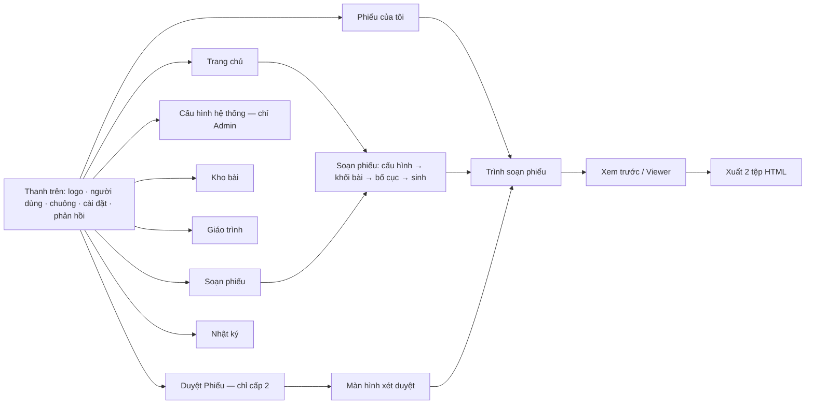
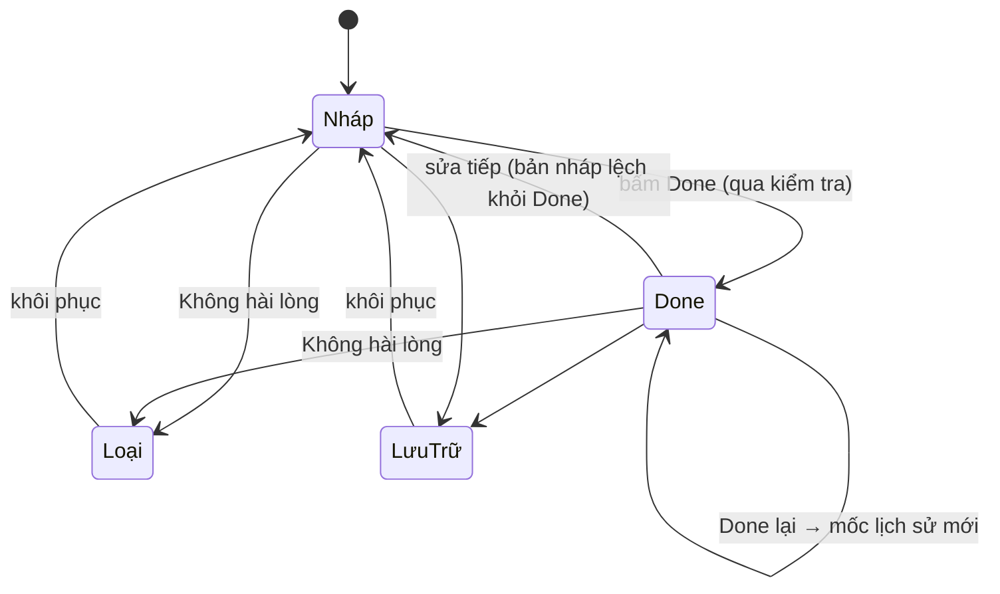
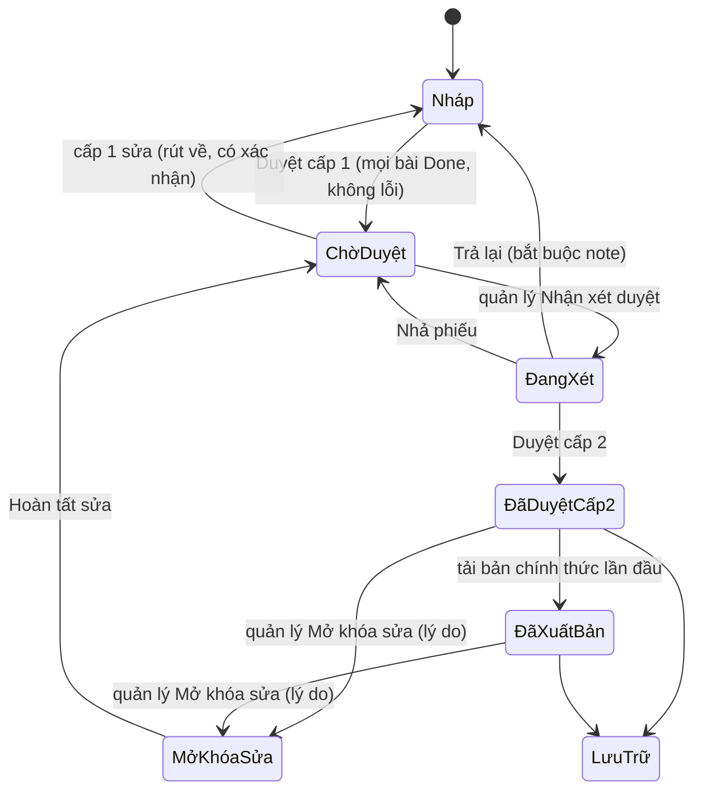

# ĐẶC TẢ MVP PROTOTYPE — ws-studio

> Mã tài liệu: **WSS-MVP-SPEC**
> Phiên bản: **3.9** · Ngày: **22/10/2026**
> Kế thừa từ: **EAA-PRD v0.5** (đặc tả sản phẩm đầy đủ). Tài liệu này **thu hẹp và cụ thể hóa** PRD cho một bản prototype chạy hoàn toàn bằng HTML.
> Ngôn ngữ tài liệu và giao diện: **Tiếng Việt**. Nội dung bài tập mẫu: **Tiếng Anh**.
> Trạng thái: **Đã build (mã nguồn `ws-studio/`, 259 kiểm tra tự động đạt); các mục còn mở nằm ở mục 19A và mục 20**

---

## 0. Cách dùng tài liệu này

- Người đọc chính: người build (Claude Code hoặc lập trình viên) và chủ sản phẩm.
- Mỗi yêu cầu có mức ưu tiên **P0** (bắt buộc cho bản trải nghiệm), **P1** (nên có), **P2** (có thể bỏ).
- Mỗi quyết định ghi rõ nguồn: **[PRD]** lấy từ EAA-PRD, **[MVP]** quyết định mới cho prototype, **[GĐ]** giả định cần xác nhận (xem mục 19).
- Khi PRD và tài liệu này mâu thuẫn, **tài liệu này thắng** cho phạm vi prototype. Các mâu thuẫn đã được xử lý ở mục 17.

---

## 1. Mục tiêu của prototype

### 1.1. Mục tiêu duy nhất

Cho người dùng **cầm lên và trải nghiệm** toàn bộ luồng soạn → duyệt hai cấp → xuất HTML tương tác của một Phiếu bài tập, để:

1. kiểm chứng **UI/UX** (bố cục, số bước, mật độ thông tin, ngôn ngữ nhãn, phản hồi trạng thái);
2. kiểm chứng **luồng vận hành** (Done, Duyệt cấp 1, Nhận xét duyệt, Trả lại, Duyệt cấp 2, khóa, phiên bản);
3. thu **phản hồi cụ thể** để chốt đặc tả sản phẩm thật (PRD v0.6 trở đi).

### 1.2. Prototype KHÔNG phải là gì

- Không phải sản phẩm dùng thật. Không có máy chủ, không có AI thật, không có đa người dùng thật.
- Không cần đúng về mặt chuyên môn sư phạm tuyệt đối. Cần **đủ giống thật** để người dùng đánh giá giao diện và luồng.
- Không tối ưu hiệu năng cho dữ liệu lớn.

### 1.3. Thước đo thành công

| Thước đo | Ngưỡng |
|---|---|
| Hoàn thành kịch bản demo S1 (mục 3) mà không cần hướng dẫn thêm | ≤ 10 phút |
| Người thử tự nói được trạng thái hiện tại của một phiếu và việc tiếp theo cần làm | 100% các trạng thái |
| Số chỗ người thử "không biết bấm đâu" ghi nhận được qua nút Phản hồi | Thu được danh sách để sửa |
| Mọi quy tắc BR bắt buộc (mục 16) thể hiện được trên giao diện | Đủ |

---

## 2. Phạm vi

### 2.1. Làm thật trong prototype (P0)

| Nhóm | Nội dung |
|---|---|
| Dữ liệu | Toàn bộ chạy trên **dữ liệu giả lập nạp sẵn (seed)**, lưu trong trình duyệt |
| Người dùng | Chuyển nhanh giữa 4 người dùng mẫu thuộc 2 vai trò (cấp 1, cấp 2) |
| Giáo trình | Duyệt cây Giáo trình → Level → Unit → Lesson, xem phạm vi cho phép của từng lesson (chỉ đọc) |
| Tạo WS | Soạn phiếu: cấu hình (kể cả theme), đề xuất và duyệt bố cục, sinh bài **giả lập** (D-76) |
| Soạn WS | Sửa tay, tạo lại theo toàn WS / bài / câu / chỉ đáp án / chỉ media, xem phiên bản và khôi phục |
| 9 loại bài | Trắc nghiệm, điền từ, nối, sắp xếp, Đúng/Sai/Không có thông tin, điền từ trắc nghiệm theo đoạn văn, biến đổi từ, viết lại câu, trả lời ngắn |
| Kiểm tra | Bộ kiểm tra quy tắc chạy thật trên dữ liệu giả lập, hiển thị lỗi, cảnh báo và điểm 6 tiêu chí |
| Duyệt | Done cấp bài; Duyệt cấp 1 → Nhận xét duyệt → Trả lại hoặc Duyệt cấp 2; mở khóa sửa; hàng chờ "Duyệt Phiếu"; ghi chú theo phiếu/bài/câu |
| Khóa và xung đột | Khóa mềm bài đang sửa; từ chối lưu khi bản nháp đã đổi (giả lập bằng bảng demo) |
| Kho bài | Tìm, lọc, xem, nhân bản, đưa vào phiếu, khôi phục, lưu trữ, loại |
| Media | Ảnh giả lập (SVG sinh tại chỗ) và audio giả lập (đọc transcript bằng giọng trình duyệt nếu có) |
| Xuất | **Tải về 2 tệp HTML độc lập**: bản giáo viên (có đáp án) và bản học sinh (không chứa dữ liệu đáp án) |
| Viewer tương tác | Xem theo trang, cuộn liên tục, toàn màn hình, xem/ẩn đáp án, zoom, phóng ảnh, điều khiển audio, lớp vẽ/ghi chú |
| Nhật ký | Nhật ký chỉ thêm (append-only), lọc được |
| Thông báo | Chuông thông báo theo từng người dùng mẫu |
| Hỗ trợ trải nghiệm | Bảng điều khiển demo, nhảy tới tình huống mẫu, đặt lại dữ liệu, nút Phản hồi gắn ngữ cảnh |

### 2.2. Mô phỏng (giả lập có chủ đích)

| Thành phần thật | Cách mô phỏng trong prototype |
|---|---|
| AI sinh bài | Bộ sinh dựa trên mẫu và kho câu của lesson, có độ trễ và tiến trình giả (mục 9) |
| AI kiểm tra ngữ nghĩa | Điểm 6 tiêu chí tính bằng công thức từ kết quả bộ kiểm tra quy tắc (mục 9.4) |
| Sinh ảnh | Chọn ngẫu nhiên có điều khiển từ bộ SVG sinh theo từ khóa lesson, độ trễ 1–2 giây |
| Sinh audio / TTS | Phát transcript bằng `speechSynthesis` nếu có; nếu không, thanh phát chạy theo thời lượng ước tính |
| Đa người dùng | Mọi người dùng dùng chung một kho dữ liệu cục bộ; chuyển người dùng bằng công tắc; xung đột và khóa được giả lập bằng bảng demo |
| Thông báo | Lưu trong dữ liệu, hiển thị khi chuyển sang người nhận |

### 2.3. Ngoài phạm vi prototype

PDF và in chuẩn, xuất Markdown cho LMS, nạp giáo trình thật, tài khoản và đăng nhập thật, máy chủ, AI thật, sinh/tải lên ảnh-audio thật, đa tổ chức, chia sẻ màn hình thời gian thực, lưu nét vẽ vào tài khoản, quản trị tiêu chuẩn/template bằng giao diện.
(Cho phép nút "In thử" gọi `window.print()` ở mức P2, không cam kết chất lượng.)

---

## 3. Kịch bản trải nghiệm chuẩn (tiêu chí nghiệm thu chính)

Prototype được coi là đạt khi chạy trọn các kịch bản dưới đây trên dữ liệu seed.

### S1. Luồng chính, người soạn (cấp 1) → quản lý (cấp 2)

1. Vào bằng **Lan (cấp 1)**. Màn hình chính cho thấy việc cần làm.
2. Bấm **Tạo phiếu mới** → chọn *Explorers English 1 → Level 1 → Unit 1 → Lesson 1.1* → thêm 3 khối: Trắc nghiệm ×4, Điền từ ×5, Đúng/Sai/Không có thông tin ×4 → **Sinh phiếu**. Xem tiến trình sinh.
3. Trong trình soạn, sửa tay một câu; tạo lại một câu khác và thấy chỉ câu đó thay đổi; xem bảng Kiểm tra.
4. Bấm **Done** cho từng bài (bài lỗi sẽ bị chặn, bấm xem lý do và sửa).
5. Bấm **Duyệt cấp 1** → phiếu sang **Chờ duyệt**, Lan thấy nhãn "đang chờ quản lý".
6. Chuyển sang **Hà (cấp 2)**. Chuông báo có phiếu mới. Vào **Duyệt Phiếu** → **Nhận xét duyệt** → để lại note ở một câu → **Trả lại** (bắt buộc có note).
7. Chuyển về Lan: thấy phiếu về Nháp kèm note; sửa; Done lại; Duyệt cấp 1 lại.
8. Chuyển sang Hà: **Duyệt cấp 2**. Nút **Tải bản chính thức** mở ra.
9. Tải 2 tệp: bản giáo viên và bản học sinh. Mở bản học sinh, xác nhận **không có đáp án trong tệp** (kể cả khi xem nguồn).

### S2. Kiểm soát chất lượng

Bật "Ép AI sinh lỗi" trong bảng demo → sinh một bài → thấy tự sửa 1 lần, một lỗi còn lại bị chặn Done với lý do rõ (từ ngoài phạm vi, sai số lượng). Sửa tay rồi Done được.

### S3. Khóa và xung đột

Trong bảng demo, bấm "Minh đang mở bài này" → mở bài đó thấy chế độ chỉ xem và dòng "Minh đang sửa". Bấm "Minh vừa lưu bản mới" rồi lưu → bị từ chối, giao diện đề nghị tải lại.

### S4. Phiếu đã khóa

Phiếu **Đã duyệt cấp 2**: Lan chỉ xem. Lan thử sửa một bài ghim trong phiếu Đang xét/Đã cấp 2 → thấy bài bị khóa, được đề nghị **Nhân bản**. Hà bấm **Mở khóa sửa** (nhập lý do) → sửa → **Hoàn tất sửa** → phiếu về Chờ duyệt.

### S5. Kho bài và tái sử dụng

Tìm bài cũ theo lesson + loại + trạng thái → xem lịch sử phiên bản → nhân bản → đưa vào một phiếu Nháp. Mở bài đã bị thay thế khỏi phiếu vẫn thấy trong kho. Bài có bản mới hơn so với bản ghim hiện cảnh báo "Có bản mới v4. Cập nhật hay giữ v3?".

### S6. Viewer tương tác

Mở bản giáo viên: chuyển 3 chế độ xem, xem/ẩn đáp án theo câu, bài, toàn phiếu; zoom; phóng ảnh; phát audio; vẽ, đánh dấu, tẩy, hoàn tác, xóa. Nét vẽ được lưu trên trình duyệt này và còn khi mở lại (D-66, thay D-17).

---

## 4. Nguyên tắc kỹ thuật cho bản build

| # | Nguyên tắc | Ghi chú |
|---|---|---|
| T1 | **Một tệp duy nhất** `ws-studio.html`, mở bằng cách bấm đúp, không cần máy chủ | Chạy được qua `file://`. Không dùng ES module nhập tệp ngoài (bị chặn CORS khi mở bằng `file://`) |
| T2 | **JavaScript thuần, CSS thuần**, không framework, không CDN, không phông tải ngoài | Font Be Vietnam Pro nhúng base64 trong bản dựng (D-120); tờ phiếu dùng font serif |
| T3 | Dữ liệu lưu `localStorage` khóa `wsstudio.v1`; nếu bị chặn, tự chuyển bộ nhớ tạm và hiện cảnh báo | Bọc mọi truy cập trong try/catch |
| T4 | **Một kho trạng thái (store)** duy nhất, thay đổi qua các hàm hành động; giao diện vẽ lại từ trạng thái | Dễ giữ luật nghiệp vụ ở một chỗ |
| T5 | Mọi luật nghiệp vụ (quyền, chuyển trạng thái, kiểm tra) nằm trong lớp **rules**, không viết rải trong giao diện | Nút bị khóa phải hiện **lý do** |
| T6 | Router theo hash (`#/trang-chu`, `#/phieu/:id`…) để có thể quay lại, đánh dấu trang | |
| T7 | Tệp xuất ra (HTML giáo viên/học sinh) là **tệp tự đủ**, có CSS và JS inline | Bản học sinh không chứa đáp án trong dữ liệu nhúng |
| T8 | Chuỗi người dùng nhập luôn được escape khi chèn vào HTML (kể cả tệp xuất) | BR-16 |
| T9 | Có hàm `selfTest()` chạy được từ bảng demo, kiểm tra bộ kiểm tra và máy trạng thái bằng các ca mẫu | Báo đạt/không đạt ngay trên giao diện |
| T10 | Trình duyệt hỗ trợ: Chrome, Edge, Safari, Firefox bản hiện hành; giao diện ưu tiên desktop ≥ 1280px; viewer dùng được trên máy tính bảng | |

Cấu trúc nội bộ tệp (theo thứ tự, khai báo ở `LAYERS` trong `build.py`, D-123): `CSS` (font nhúng, token app, viewer) → `Viewer dùng chung` (`viewer.js`) → **dữ liệu** (`data.js`: giáo trình, theme, tiêu chuẩn, bố cục, người dùng) → **lõi** (`core.js`: tiện ích, store, lưu trữ) → **miền** (`validator.js` tiêu chuẩn và bộ kiểm tra → `mockai.js` sinh, tự sửa, dàn khối, media giả lập → `rules.js` quyền, máy trạng thái, khóa, tiến độ lesson → `importers.js` nhập giáo trình và kiểm tệp lesson → `seed.js` dữ liệu mẫu → `export.js` dựng tệp xuất) → **giao diện** (`ui.js`, `actions.js`) → **màn hình** (`views-*.js`) → **khởi động** (`app.js`: router, bảng demo, `selfTest()`). Màn hình chỉ vẽ và gọi hành động; luật nghiệp vụ và xử lý dữ liệu nằm ở lớp miền (D-121).

---

## 5. Vai trò và người dùng mẫu

### 5.1. Người dùng mẫu (chuyển bằng công tắc ở góc trên)

| Tên | Vai trò | Dùng để thử |
|---|---|---|
| **Lan** | Cấp 1 (người soạn) | Luồng soạn chính |
| **Minh** | Cấp 1 (người soạn khác) | Khóa mềm, xung đột, bài của người khác |
| **Hà** | Cấp 2 (quản lý) | Duyệt, trả lại, mở khóa |
| **Quang** | Cấp 2 (quản lý, cũng soạn phiếu) | Quy tắc không tự duyệt phiếu mình soạn (BR-17) |
| **Thu** | Admin (quản trị hệ thống) | Cấu hình hệ thống: giáo trình, theme, thư viện bố cục (D-77) |

Chuyển người dùng **không cần mật khẩu** [MVP]. Người dùng hiện tại luôn hiện rõ ở thanh trên (tên, vai trò, màu nhận diện).

### 5.2. Bảng quyền cho prototype

| Hành động | Cấp 1 | Cấp 2 |
|---|---|---|
| Xem mọi phiếu (D-42) | ✔ | ✔ |
| Tạo/sửa phiếu ở trạng thái Nháp | ✔ chỉ phiếu của mình | ✔ |
| Done bài, ghim bài vào phiếu | ✔ | ✔ |
| Duyệt cấp 1 | ✔ | ✔ |
| Sửa phiếu Chờ duyệt | ✔ nhưng **tự rút về Nháp** (có xác nhận) | Xem; **Nhận xét duyệt** để vào Đang xét |
| Sửa phiếu Đang xét | ✘ chỉ xem, hiện "đang được X xét" | ✔ độc quyền |
| Duyệt cấp 2 / Trả lại | ✘ | ✔ (Duyệt cấp 2 **không** áp dụng cho phiếu do chính mình soạn, trừ khi bật cài đặt "cho phép tự duyệt", có ghi log) |
| Sửa phiếu Đã duyệt cấp 2 | ✘ | Chỉ sau **Mở khóa sửa** (bắt buộc lý do) |
| Tải bản chính thức (HTML giáo viên/học sinh) | ✘ | ✔ |
| Xem trước | ✔ mọi trạng thái, kèm nhãn "chưa duyệt cấp 2" nếu chưa đạt | ✔ |
| Gỡ khóa mềm của người khác | ✘ | ✔ |

**Quyền cấu hình hệ thống (D-77):**

| Hành động | Cấp 1 | Cấp 2 | Admin |
|---|---|---|---|
| Xem giáo trình, theme, thư viện bố cục | ✔ | ✔ | ✔ |
| Nhập/sửa giáo trình, level, unit, lesson | ✘ | ✘ | ✔ |
| Thêm/sửa/ngừng dùng theme | ✘ | ✘ | ✔ |
| Thêm/sửa thư viện bố cục dàn trang | ✘ | ✘ | ✔ |
| Soạn phiếu, Cấu hình phiếu | ✔ | ✔ | ✔ |

Admin có thể xem mọi phiếu nhưng không duyệt phiếu (tách vai trò). Cấu hình phiếu (giáo trình/level/unit/lesson, theme, bố cục) do **người dùng lập theo từng phiếu**.

**Ghi chú quyết định [GĐ-1]:** PRD ghi người dùng cấp 1 "không tải bản chính thức khi phiếu chưa qua cấp 2" và cấp 2 được tải. Prototype hiểu là: **phiếu đã cấp 2 thì cả cấp 1 và cấp 2 đều tải được** (cấp 1 là người cần phát bài). Xin xác nhận, mặc định trong bảng trên là chỉ cấp 2 tải để bám sát PRD; công tắc ở Cài đặt đổi được.

---

## 6. Sơ đồ điều hướng



Thanh bên trái (nav chính) hiển thị: Trang chủ, **Soạn phiếu** (nút nổi bật, D-76), Phiếu, Kho bài, Giáo trình, Duyệt Phiếu (có số huy hiệu), Nhật ký, **Cấu hình hệ thống** (chỉ Admin). Mục **Duyệt Phiếu chỉ hiện với cấp 2**.

---

## 7. Đặc tả màn hình

> Quy ước: mọi màn hình phải có **trạng thái rỗng**, **trạng thái đang tải** (khi có độ trễ giả) và **thông báo lỗi** dùng ngôn ngữ dễ hiểu. Mọi nút bị vô hiệu hóa phải hiện **lý do** khi rê chuột hoặc chạm giữ (tooltip).

### 7.1. Dashboard (thay Trang chủ, D-113) [P0]

Mục đích: tổng quan tiến độ giáo trình và người làm, kèm "việc của tôi".

- Khối **Giáo trình đang làm và tiến độ**: mỗi giáo trình một thẻ (tên, phiên bản, nhãn Đang làm / Chưa bắt đầu, cập nhật lúc nào, người đang làm, số phiếu, % lesson đã duyệt). Thanh tiến độ chồng bốn trạng thái lesson: **Đã duyệt** (có phiếu Đã duyệt cấp 2 hoặc Đã xuất bản), **Đang duyệt**, **Đang soạn**, **Chưa có phiếu**. Chi tiết **từng Level** (số lesson, thanh tiến độ, số phiếu, số lesson đủ tệp kiến thức và skill theo D-112); bấm Level để xem từng lesson. Giáo trình đang làm xếp trước.
- Khối **Người làm và kết quả**: mỗi người một dòng: số phiếu, nháp, bị trả lại, đang duyệt, đã duyệt cấp 2, **tỷ lệ qua duyệt** (đã duyệt / đã nộp duyệt, gồm đang duyệt và bị trả lại), bài Done, vai trò duyệt (đã duyệt, trả lại), hoạt động gần nhất. Cách tính "kết quả" là đề xuất, chờ xác nhận.

- Khối **Cần làm ngay** theo vai trò:
  - Cấp 1: phiếu bị **Trả lại** (kèm số note), bài **Nháp có thay đổi chưa Done**, phiếu đang soạn dở.
  - Cấp 2: số phiếu **Chờ duyệt**, phiếu mình **đang xét** dở, yêu cầu mở khóa.
- Khối **Phiếu gần đây** (thẻ: tiêu đề, lesson, trạng thái, người soạn, cập nhật lúc nào).
- Nút lớn **Tạo phiếu mới**; lối tắt **Mở kho bài**.
- Khối **Thử nhanh tình huống** (liên kết tới các tình huống seed, xem mục 12.3).

### 7.2. Giáo trình [P0, chỉ đọc]

- Bên trái: cây Giáo trình → Level → Unit → Lesson, có thu gọn/mở rộng.
- Bên phải (khi chọn một lesson): **Phạm vi được phép**: mục tiêu, từ vựng, ngữ pháp/cấu trúc, kỹ năng, chủ đề, **nội dung cấm/chưa học**, đoạn văn nguồn.
- Hiển thị phiên bản giáo trình và số bài/phiếu đã tạo từ lesson đó.
- Có dòng chú thích "Dữ liệu giả lập" [MVP].

### 7.3. Soạn phiếu: cấu hình và bố cục [P0, D-76…D-80]

Menu **Soạn phiếu** dẫn người dùng qua **6 bước** trên một thanh tiến trình chung (D-119). Bốn bước đầu là **tạo phiếu** (cấu hình, dàn khối, bố cục, sinh); hai bước sau là **làm việc với phiếu** (biên tập, duyệt cấp 1). Có thể quay lại các bước trước khi chưa sinh.

```
1 Thông tin & phạm vi → 2 Khối bài → 3 Bố cục (duyệt) → 4 Sinh → 5 Biên tập (sửa + Done) → 6 Duyệt cấp 1
```

Các đoạn dưới giữ tên gọi cũ: **Cấu hình phiếu** = bước 1 và 2 (thông tin, phạm vi, theme, rồi tự dàn khối bài, D-98); **Bố cục** = bước 3; **Sinh** = bước 4.

**Bước 1 và 2 — Cấu hình phiếu** (do người dùng lập cho từng phiếu; sửa lại được ngay cả khi đang biên tập, D-83)
- Tiêu đề phiếu (gợi ý từ lesson), ghi chú chung.
- Chọn lần lượt **Giáo trình → Level → Unit → Lesson**, lấy từ dữ liệu Cấu hình hệ thống (mục 7.15); ô sau bị khóa cho tới khi ô trước chọn (FR-02). Công tắc "Dùng nhiều lesson" (mặc định tắt, D-06).
- **Theme** (D-79): chọn từ **kho theme** (thẻ có tên, mô tả ngắn, ví dụ bối cảnh). Theme chỉ là **câu chuyện, bối cảnh** bao quanh kiến thức ngôn ngữ; không đổi và không được vượt từ vựng, ngữ pháp của lesson. Mỗi phiếu một theme; có lựa chọn "Không dùng theme". Trước mắt chỉ chọn từ kho; tự viết mô tả và tải tệp theme md là bước sau (D-79).
- Tóm tắt **phạm vi cho phép** của lesson hiện ngay bên phải (như 7.2, rút gọn), kèm theme đang chọn.
- Thời lượng mục tiêu của phiếu (phút), số bài mong muốn (không bắt buộc): dùng làm căn cứ đề xuất bố cục.

**Bước 3 — Bố cục** (D-80); **Bước 4 — Sinh** là màn tiến trình theo từng bài ở cuối bước này
- Bấm **Đề xuất bố cục**: hệ thống tự lên **danh sách các bài sẽ tạo** từ mục tiêu lesson, level, thời lượng và dữ liệu có cấu trúc của giáo trình. Mỗi bài trong bố cục có: loại bài, số câu, độ khó, đáp án/giải thích (bật/tắt), **ghi chú cho AI**, và **một dòng lý do** (ví dụ "Lesson có 8 từ vựng mới nên mở đầu bằng nối từ").
- Người dùng **duyệt hoặc chỉnh**: thêm/xóa bài, đổi loại, số câu, độ khó, thứ tự (nút lên/xuống; kéo thả P2). Số câu bị giới hạn theo Standard profile, vượt thì chặn kèm lý do.
- Nút **Lưu làm mẫu bố cục** [P1], **Thêm từ kho bài** [P1].
- Bảng tóm tắt cuối bước: phạm vi, theme, danh sách bài, tiêu chuẩn áp dụng (tên + phiên bản).
- Bấm **Duyệt bố cục và sinh** → màn **tiến trình theo từng bài** (*Lấy học liệu lesson → Nạp tiêu chuẩn → Nạp theme → Sinh nội dung → Kiểm tra → Tự sửa*; mục 9), có **Chạy nền và rời màn hình** (FR 14.2). Xong, chuyển sang Biên tập (7.4).

**Sửa cấu hình khi đang biên tập (D-83):** nút "Cấu hình phiếu" ở thanh trên mở lại bước 1 đến 3. Đổi theme hoặc lesson thì hỏi "Sinh lại các bài chưa Done" (mặc định) hoặc "Giữ nguyên nội dung hiện có". Bài đã Done luôn được giữ; nếu khác theme/lesson với cấu hình mới thì hiện nhãn "Khác cấu hình hiện tại".

### 7.4. Trình soạn phiếu [P0] — màn hình trung tâm

```
┌────────────────────────────────────────────────────────────────────────────┐
│ Tiêu đề phiếu ✎  [Nháp]  Lesson 1.1  · người soạn   [Xem trước][⋯][Duyệt cấp 1]│
├───────────────┬─────────────────────────────────────────┬──────────────────┤
│ MỤC LỤC       │ BÀI 2 · Điền từ            [Done] [⋯]   │ KIỂM TRA│NGUỒN│… │
│ ① Trắc nghiệm │ Hướng dẫn: …                            │ ● 0 lỗi 2 cảnh báo│
│    Done v2 ✔  │ Câu 1  …  ___ …          [✎][↻][🗑]     │ Bám nguồn      92 │
│ ② Điền từ     │ Câu 2  …                 [✎][↻][🗑]     │ Đúng level     85 │
│    Nháp ●     │ …                                       │ Đúng loại bài  100│
│ ③ Đ/S/KCT     │ [+ Thêm câu]                            │ Đúng mục tiêu  88 │
│ [+ Thêm bài]  │ Media: [Ảnh] [Audio]                    │ Đáp án rõ ràng 95 │
│ [Thêm từ kho] │ Đáp án & giải thích ▾                   │ An toàn        100│
└───────────────┴─────────────────────────────────────────┴──────────────────┘
```

**Bố cục màn hình biên tập (D-81, thay sơ đồ 3 cột ở trên):** chia **hai nửa**. **Nửa trái = Soạn**, **nửa phải = Preview** (rộng khoảng 40–45%, nhỏ hơn nửa soạn một chút), kéo thanh giữa để đổi tỷ lệ. Mục lục bài thu thành dải ngang/ngăn trượt ở đầu nửa trái; bảng Kiểm tra, Nguồn, Lịch sử, Ghi chú thành các tab trong nửa trái. Mọi thay đổi ở nửa trái hiện **ngay** ở Preview (cuộn tới đúng bài đang sửa). Preview có biểu tượng **toàn màn hình** để giáo viên tự thao tác trải nghiệm như viewer (mục 7.8); thoát thì về lại màn biên tập.

- Nửa Soạn thao tác theo từng bài: sinh lại cả bài hoặc từng câu (có hướng dẫn, 3 phương án), sửa tay tại chỗ, **gen ảnh**, **gen audio** (và video mô phỏng) khi bài cần, đổi **thứ tự** bài, chọn **bố cục hiển thị** của bài (D-82).
- Mỗi bài có nút **Done** xác nhận trạng thái bài, làm cơ sở lưu lịch sử của bài (như mục 8.1).
- Khi phiếu xong, nút **Duyệt cấp 1** lưu nội dung và lịch sử, đẩy phiếu vào hàng chờ duyệt cấp 2 (D-84).

**Bố cục hiển thị từng bài (dàn trang, D-82):** lấy từ **thư viện bố cục** do Admin quản lý (mục 7.15). Mặc định **một cột chạy một mạch từ trên xuống**; có kiểu **một cột kèm cột ảnh** cho bài có ảnh. Bài nhiều nội dung (nhiều câu, đoạn văn dài) thì hệ thống **gợi ý đổi bố cục** (ví dụ hai cột, đoạn văn bên trái và câu hỏi bên phải) kèm xem trước; người dùng đồng ý hoặc giữ nguyên. Chuyển bố cục không đổi nội dung bài, chỉ đổi cách dàn trang trong Preview, viewer và tệp xuất.

**Thanh trên cùng**
- Tên phiếu sửa tại chỗ; **chip trạng thái** (màu theo mục 14.2); tên người đang giữ khóa/đang xét nếu có.
- Nút chính thay đổi theo trạng thái và quyền: `Duyệt cấp 1` / `Rút về Nháp` / `Nhận xét duyệt` / `Duyệt cấp 2` + `Trả lại` / `Mở khóa sửa` / `Hoàn tất sửa` / `Tải bản chính thức`. Mỗi nút bị vô hiệu hóa phải nêu lý do (ví dụ "Còn 1 bài chưa Done").
- Menu `⋯`: Nhân bản phiếu, Lịch sử phiếu, Cài đặt phiếu (số trang bìa, thông tin lớp, vùng ghi chú, điểm số, thời lượng) [P1], Lưu trữ.

**Cột trái — Mục lục**
- Danh sách bài theo thứ tự, mỗi bài hiện: số, loại, số câu, **nhãn trạng thái bài** (mục 14.2), biểu tượng khóa nếu bị khóa.
- Nút lên/xuống, xóa khỏi phiếu (không xóa khỏi kho, BR-06), **Thêm bài** (sinh mới), **Thêm từ kho**.
- Bài có bản Done mới hơn bản đang ghim → huy hiệu "Có bản mới".

**Cột giữa — Khung soạn bài đang chọn**
- Tiêu đề bài, hướng dẫn (sửa được), danh sách câu, mỗi câu có **✎ Sửa**, **↻ Tạo lại câu**, **🗑 Xóa**, **💬 Ghi chú** (cho quản lý).
- Phần **Đáp án & giải thích** thu gọn được; có nút **↻ Chỉ tạo lại đáp án/giải thích**.
- Phần **Media**: gắn ảnh/audio ở cấp phiếu, bài hoặc câu (mục 11).
- Thanh hành động bài: **↻ Tạo lại bài**, **Sửa tay**, **Done**, `⋯` (Nhân bản, Lưu vào kho, Đánh dấu Không hài lòng/Loại, Lịch sử bài).
- **Làm lại theo phạm vi:** trước khi thay, hiện hộp xác nhận nêu đúng phạm vi bị thay ("Sẽ thay: Câu 3 của Bài 2. Giữ nguyên: 11 câu còn lại"), có nút **Xem so sánh** (diff cũ/mới) và **Hoàn tác** ngay sau đó (BR-11, FR-08). **Tạo lại câu/bài hiện 3 phương án** để giáo viên chọn một (D-26); chỉ khi chọn mới thay vào phiếu, các phương án còn lại bị bỏ.
- **Chế độ chỉ đọc** khi người dùng không có quyền hoặc bài bị khóa: toàn bộ nút sửa bị ẩn/vô hiệu, có dải thông báo nêu lý do và hành động thay thế (Nhân bản / Sửa tay tạo bản riêng).

**Cột phải — Tab**
- **Kiểm tra**: danh sách lỗi/cảnh báo theo mức độ, bấm vào nhảy tới câu liên quan; **điểm 6 tiêu chí** (mục 9.4) với lời giải thích ngắn.
- **Nguồn**: giáo trình, level, unit, lesson, phiên bản giáo trình, Standard profile + phiên bản, tham số sinh, nguồn nội dung (AI sinh / người sửa) (FR-17, 14.4).
- **Lịch sử**: tab con *Bài* (các mốc Done) và *Phiếu* (các phiên bản phiếu); mỗi mốc có **Xem**, **So sánh**, **Khôi phục** [P0].
- **Nhận xét**: ghi chú của quản lý theo phiếu/bài/câu, đánh dấu đã xử lý [P0].

**Hành vi Done (P0):**
- Chỉ Done được khi **không còn lỗi mức "Lỗi"**; cảnh báo cho phép Done sau khi người dùng xác nhận đã đọc (BR-04, BR-09).
- Mỗi lần bấm Done tạo một mốc mới trong lịch sử bài (D-12). Sau Done vẫn sửa tiếp; bài hiện nhãn "đã sửa sau Done" cho tới khi Done lại.
- Bài chưa Done **không được ghim** vào phiếu; khi thêm bài từ kho chỉ liệt kê bài đã có bản Done.

**Tự lưu:** mỗi thay đổi lưu bản nháp ngay; hiện "Đã lưu lúc hh:mm". Giữa chừng có thể "mất kết nối giả lập" từ bảng demo để xem trạng thái lỗi lưu.

### 7.5. Trình soạn từng loại bài [P0]

Mỗi loại có **giao diện sửa riêng** và **cách hiển thị trong viewer**. Chi tiết dữ liệu ở mục 10.2.

| Loại bài | Giao diện sửa | Hiển thị cho học sinh |
|---|---|---|
| Trắc nghiệm (`mcq`) | Đề + 3–4 lựa chọn, chọn 1 đáp án đúng bằng nút radio | A/B/C/D |
| Điền từ (`fill_blank`) | Câu có `___`, danh sách đáp án chấp nhận; tùy chọn khung từ (word bank) | Câu có ô trống (gạch dưới) |
| Nối (`matching`) | Hai cột; kéo nối hoặc chọn cặp bằng dropdown; có thể thêm mục gây nhiễu | Hai cột có số/chữ |
| Sắp xếp (`ordering`) | Danh sách từ/cụm/câu theo thứ tự đúng; hệ thống tự xáo | Các mục đã xáo, kèm ô đánh số |
| Đúng/Sai/Không có thông tin (`tfng`) | Đoạn văn chung + các nhận định, chọn T/F/NG | Đoạn văn + nhận định + 3 ô chọn |
| Điền từ trắc nghiệm theo đoạn (`cloze_mcq`) | Đoạn văn có `{1}`, `{2}`…; mỗi chỗ trống có 3–4 lựa chọn | Đoạn văn với chỗ trống đánh số + bảng lựa chọn |
| Biến đổi từ (`word_form`) | Câu có chỗ trống + từ gốc in hoa; đáp án chấp nhận | Câu có ô trống, từ gốc ở bên cạnh |
| Viết lại câu (`rewrite`) | Câu gốc, phần mở đầu, đáp án chấp nhận (nhiều dạng) | Câu gốc + dòng viết lại |
| Trả lời ngắn (`short_answer`) | Câu hỏi, giới hạn số từ, danh sách đáp án chấp nhận | Câu hỏi + dòng kẻ |

### 7.6. Kho bài [P0]

- Dạng bảng/thẻ chuyển đổi; **bộ lọc**: giáo trình, level, unit, lesson, loại bài, trạng thái, người tạo, ngày, tag, từ khóa (có thể thu gọn); phân trang.
- Mỗi hàng: tiêu đề/đoạn đề, loại, lesson, trạng thái, phiên bản mới nhất, người tạo, **dấu tương thích** ("Còn tương thích" / "Giáo trình đã đổi phiên bản"), số phiếu đang dùng.
- Hành động: **Xem**, **Mở sửa**, **Tạo bài mới từ mẫu này** (luồng dùng lại chính, D-33: giữ loại bài, cấu trúc, phạm vi; hiện 3 phương án nội dung mới hoặc cho sửa tay), **Nhân bản** (hỏi: tạo bản sao độc lập hay bản phát sinh, ghi nhận nguồn gốc theo FR-11.7), **Đưa vào phiếu…** (chọn phiếu Nháp đích), **Lịch sử**, **Lưu trữ**, **Không hài lòng/Loại**, **Khôi phục**.
- Phát hiện trùng khi nhân bản hoặc lưu vào kho (cảnh báo "Đã có bài rất giống", FR-13.3) [P1].
- Bài bị Loại hoặc Lưu trữ nằm trong tab riêng; bài Loại **không dùng lại như bài Done** nếu chưa tái Done (BR-10).

### 7.7. Duyệt Phiếu (chỉ cấp 2) [P0]

**Danh sách (hàng chờ)**
- Bảng các phiếu: tiêu đề, người soạn, thời điểm Duyệt cấp 1, số bài, số cảnh báo, trạng thái (Chờ duyệt / Đang xét bởi ai), thời gian chờ.
- Tab: *Chờ duyệt*, *Đang xét*, *Đã duyệt*, *Đã trả lại*.
- Hành động trên hàng: **Nhận xét duyệt** (chuyển Đang xét, đặt khóa độc quyền).

**Màn hình xét duyệt (một phiếu)**
- Bố cục như Trình soạn nhưng **ưu tiên nhận xét**: cột phải mặc định là tab Nhận xét; mỗi phiếu/bài/câu có nút **Thêm note** (loại: *Đề nghị sửa* hoặc *Ghi chú*).
- Thanh hành động cuối:
  - **Duyệt cấp 2** (vô hiệu hóa kèm lý do nếu: còn note "Đề nghị sửa" chưa xử lý, còn bài đã sửa mà chưa Done, hoặc quản lý là người soạn mà chưa bật tự duyệt).
  - **Trả lại** (bắt buộc ghi note tổng hợp, BR-20).
  - **Tự sửa trực tiếp**: mở khung soạn; sửa bài thì quản lý **phải Done** bài đó trước khi Duyệt cấp 2; người soạn nhận thông báo "Hà đã sửa Bài 2" (FR-18.8).
- Khi quản lý thoát giữa chừng, phiếu giữ nguyên **Đang xét** cho tới khi Duyệt/Trả lại hoặc **Nhả phiếu** (về Chờ duyệt).

### 7.8. Xem trước và Viewer HTML tương tác [P0]

Một thành phần dùng chung cho (a) **xem trước trong ứng dụng** và (b) **tệp HTML xuất ra**.

**Chế độ xem**: Theo trang (khổ A4 dọc, giống bản in) · Cuộn liên tục · Toàn màn hình/Trình chiếu · Điều hướng tới trang/bài/câu (hộp "Đi tới").

**Bố cục hiển thị (D-60…D-65):** áp dụng cho cả xem trước thường và Trình chiếu.
- **1 trang** hoặc **2 trang cạnh nhau** trong một màn hình (D-60). Ở chế độ 2 trang, lật theo **cặp** (1-2, 3-4…) (D-62). Chế độ Cuộn giữ nguyên.
- **Phóng to một bài (D-61):** trước tiêu đề mỗi bài có nút phóng to; bấm thì bài đó chiếm cả màn hình, vừa chiều rộng và cuộn dọc nếu dài hơn một màn (D-63). Có ◀ ▶ "Bài trước/Bài sau" và nút "Về tổng"/`Esc` (D-64). Nét vẽ gắn với trang nên còn nguyên khi quay về màn tổng (D-65).
- **Nút thao tác ngay trên trang (D-61):** nút nghe audio, ảnh (bấm ảnh là nút, mở xem full ở cả màn tổng và màn một bài), video (bấm để phát). Audio, ảnh, video của một bài hiện **đồng thời**.
- **Phóng to tự do (D-61):** nút riêng, kéo chọn vùng để phóng lên. Chỉ phóng hiển thị; nút trên trang vẫn bấm được; nét vẽ phóng cùng nội dung (D-64). Thoát bằng "Về tổng"/`Esc`.
- **Video (D-60, mô phỏng):** thêm loại media video vào bài (khung phát + tệp mẫu ngắn, có phụ đề/mô tả), xem mục 11.

**Công cụ trình bày (D-67…D-74):** nhóm "🧰 Trình bày" (menu) gom các công cụ dưới đây, mỗi cái có phím tắt; mặc định tất cả tắt.

| Công cụ | Phím | Hành vi |
|---|---|---|
| Thanh công cụ tự ẩn (D-67) | `H` | Trình chiếu mở ra là ẩn thanh; rê chuột lên mép trên (hoặc chạm vạch mép trên) để hiện, rời ra thì ẩn |
| Che câu (D-68) | `C` | Che tất cả câu và đoạn văn; bấm vào từng câu để hé, bấm lại để che; tắt thì hé hết |
| Rèm kéo (D-68) | `R` | Tấm rèm từ mép trên, kéo thanh ở mép dưới để hạ/nâng, che phần phía dưới |
| Tối màn / Trắng màn (D-68) | `B` / `W` | Phủ kín màn hình; bấm chuột hoặc phím bất kỳ để quay lại |
| Đèn rọi (D-69) | `L` | Làm tối toàn màn hình trừ vòng tròn theo con trỏ; `Alt` + lăn chuột đổi cỡ |
| Hiện đáp án lần lượt (D-70) | `Space` (`Shift+Space`: lùi) | Hiện đáp án câu kế tiếp trong phần đang xem (cả màn hình, hoặc bài đang phóng); chỉ bản giáo viên; có nút "Câu kế" |
| Ghi chú giáo viên (D-71) | nút 📝 ở đầu bài | Hộp ghi chú nhỏ của từng bài, chỉ bản giáo viên, chỉ mở khi bấm nên không lộ lên màn chiếu ngoài ý muốn; lưu cục bộ |
| Đồng hồ đếm giờ (D-72) | `T` | 1′, 3′, 5′, 10′, ±1′, bắt đầu/tạm dừng/đặt lại; hết giờ nháy và phát tiếng bíp |
| Bảng trắng (D-73) | `K` | Một trang trắng riêng ngoài các trang phiếu (không tính vào số trang), tự bật Bút khóa; bấm lại hoặc `Esc` để về phiếu |
| Ghim bài (D-74) | ☆ ở đầu bài; `1`…`9` | Bài ghim hiện đầu danh sách "Đi tới" với dấu ★; phím số nhảy tới bài tương ứng |

**Thanh công cụ** (thu gọn/di chuyển được, không che nội dung):

| Nhóm | Chức năng |
|---|---|
| Đáp án (chỉ bản giáo viên) | Xem/ẩn đáp án một câu, một bài, toàn phiếu; xem/ẩn giải thích |
| Zoom | Phóng/thu toàn phiếu, về tỷ lệ mặc định; cử chỉ chụm (cảm ứng) |
| Ảnh | Chạm ảnh → lớp xem riêng: phóng/thu, kéo, đóng quay lại đúng vị trí |
| Audio | Phát/tạm dừng, tua, phát lại, âm lượng, tốc độ (0.75×, 1×, 1.25×) |
| Vẽ/ghi chú | Bút, bút đánh dấu, tẩy, màu, độ dày, hoàn tác/làm lại, xóa tất cả, bật/tắt hiển thị lớp |

**Quy tắc:**
- Hỗ trợ chuột, cảm ứng, stylus (Pointer Events).
- Nét vẽ, ghi chú giáo viên, bài đã ghim và bố cục 1/2 trang **lưu trên trình duyệt này** theo mã phiếu + phiên bản + loại bản (D-66, thay D-17); không đồng bộ giữa máy. Trình duyệt không cho lưu thì báo "Nét vẽ sẽ mất khi đóng trang".
- Mọi thao tác trong viewer **không đổi nội dung gốc** (BR-14).
- Media lỗi: khung báo lỗi + nút **Thử lại**, phần khác vẫn chạy.
- **Bút vẽ theo phím giữ (D-56…D-59):** viewer **luôn mở ở trạng thái Con trỏ**; lớp vẽ không bắt chuột, nên bấm ảnh, nút, đáp án hoạt động bình thường. Giữ phím để vẽ tạm thời, **thả phím là về Con trỏ** (nét đang vẽ dở được hoàn tất trước; mất focus cửa sổ cũng về Con trỏ).

| Giữ phím + kéo chuột | Kết quả | Mặc định |
|---|---|---|
| `Shift` | Đường thẳng, **chỉ ngang hoặc dọc** (tự khóa theo hướng kéo lệch nhiều hơn) | Bút nét vừa, đỏ |
| `Ctrl` (Mac: `Cmd`) | **Bút đánh dấu** vẽ tự do | Nét vừa, vàng |
| `Ctrl` + `Shift` | **Hình chữ nhật** (chỉ viền) | Bút nét vừa, đỏ |
| Không giữ phím, đang ở **Bút (khóa)** | Vẽ tự do như bút thường | Màu và nét theo thanh công cụ |

  Nút "Vẽ"/phím `P` giữ lại, đổi tên **"Bút (khóa)"**, dành cho cảm ứng/bút cảm ứng không có phím; `Esc` hoặc bấm lại để về Con trỏ. Thanh công cụ (màu, độ dày, tẩy, hoàn tác) giữ như cũ. Đường thẳng và hình chữ nhật có xem trước khi kéo, vào chung ngăn xếp hoàn tác/làm lại, và tẩy xóa được. Các nét theo phím giữ có **màu cố định** như bảng trên; độ dày lấy theo thanh công cụ (mặc định Vừa).
- Phím tắt: `←/→` đổi trang, `+/-` zoom, `A` bật/tắt đáp án, `P` bút, `E` tẩy, `Esc` thoát toàn màn hình/đóng ảnh. Có nhãn truy cập cho trình đọc màn hình ở các nút chính.
- **Xem trước trong ứng dụng** luôn gắn dải "Bản xem trước · chưa duyệt cấp 2" nếu phiếu chưa đạt; có công tắc **Xem như học sinh** để kiểm tra bản không đáp án.

### 7.9. Xuất bản [P0]

- Nút **Tải bản chính thức** chỉ khả dụng khi phiếu **Đã duyệt cấp 2** (BR-18); nếu không, hiện lý do và lối xem trước.
- Hộp thoại xuất: chọn *Bản giáo viên*, *Bản học sinh*, hoặc *cả hai* (mặc định cả hai, D-14); hiển thị tên tệp sẽ tạo: `<ma-phieu>_v<phien-ban>_giao-vien.html`, `…_hoc-sinh.html`.
- Chạy **bộ kiểm tra xuất bản** (BR-16): tài nguyên đủ, cấu trúc hợp lệ, **bản học sinh không chứa đáp án** (kiểm bằng cách quét dữ liệu nhúng), chuỗi đã escape. Có kết quả đạt/không đạt từng mục.
- Sau khi tải lần đầu, phiếu có huy hiệu **Đã xuất bản** kèm phiên bản và thời điểm; ghi nhật ký.
- **Mã phiếu và số phiên bản trong mọi tệp xuất (D-50):** tên tệp đã có (`<ma-phieu>_v<phien-ban>_...`); bên trong tệp có thêm khối metadata đọc được bằng máy (thẻ `<meta name="ws-id">`, `ws-version`, và khối `<script type="application/json" id="ws-meta">` gồm mã phiếu, số phiên bản, thời điểm xuất, người xuất, loại bản giáo viên/học sinh, giáo trình-level-unit-lesson và phiên bản giáo trình/tiêu chuẩn đã dùng). Khối metadata của bản học sinh **không chứa đáp án**. Mục đích: hệ thống chuyên dụng nhận biết cập nhật thay vì tạo trùng.
- **Hai cách chuyển sang hệ thống chuyên dụng (D-49):** (1) **tải về rồi nhập tay** — làm thật; (2) **đẩy tự động qua API** — chỉ **mô phỏng** [P2]: ô cấu hình địa chỉ giả ở Cài đặt, nút *Đẩy sang hệ thống chuyên dụng*, kết quả thành công/thất bại giả lập có thử lại, ghi nhật ký.
- **Xuất dữ liệu có cấu trúc (JSON) [P1, GĐ-8]:** vì định dạng hệ thống kia nhận chưa chốt (D-51), prototype có nút *Xuất JSON* (toàn bộ phiếu, bài, câu, đáp án, media tham chiếu, kèm mã phiếu/phiên bản) để thử nối với hệ thống kia. Bản JSON chỉ tải được khi phiếu đã duyệt cấp 2 (BR-18).

### 7.10. Nhật ký [P0]

- Bảng chỉ thêm (không sửa/xóa): thời điểm, người, hành động, đối tượng (phiếu/bài/câu/media), bản trước → sau, ghi chú.
- Lọc theo người, hành động, đối tượng, khoảng thời gian; bấm một dòng → mở đối tượng liên quan.
- Các hành động bắt buộc ghi: tạo, sửa, tạo lại, Done, Duyệt cấp 1, Nhận xét duyệt, Trả lại, Duyệt cấp 2, Mở khóa sửa, Hoàn tất sửa, rút về Nháp, thêm/thay/xóa media, tách/nhân bản, xuất, tự duyệt, gỡ khóa (FR-17, FR-18.13).

### 7.11. Cài đặt (tối giản) [P1]

| Cài đặt | Mặc định |
|---|---|
| Cho phép người duyệt cấp 2 tự duyệt phiếu mình soạn (BR-17) | Tắt |
| Thời gian tự nhả khóa mềm | 120 giây (demo có thể chỉnh 15 giây) |
| Cấp 1 cũng được tải bản chính thức (GĐ-1) | Tắt |
| Độ nghiêm ngặt của kiểm tra từ vựng | Chuẩn (có "Chặt"/"Lỏng") |
| Độ trễ giả của AI | Vừa (có "Nhanh"/"Chậm") |

---

### 7.14. Soạn bài chuyên sâu và tuân thủ tiêu chuẩn [P0, D-52] — đề xuất, chờ xác nhận chi tiết

Đây là **trọng tâm số 1** của app (D-52). Mọi chặng build phải ưu tiên phần này trước viewer, media và xuất bản.

**A. Tiêu chuẩn nhìn thấy được và dùng được khi soạn**

| # | Chức năng | Ưu tiên |
|---|---|---|
| A1 | **Màn Tiêu chuẩn** (chỉ đọc): danh sách Standard profile theo loại bài, từng quy tắc, ngưỡng, mức chặn/cảnh báo, phiên bản | P0 |
| A2 | **Bảng tuân thủ theo bài** trong trình soạn: checklist toàn bộ quy tắc của profile (đạt / cảnh báo / lỗi), bấm để nhảy tới câu vi phạm; mỗi quy tắc có lời giải thích "vì sao" | P0 |
| A3 | **Đánh dấu ngay trên văn bản (inline):** từ ngoài phạm vi gạch chân vàng, từ/cấu trúc cấm gạch đỏ, câu quá dài hiện chỉ báo; rê chuột/chạm xem lý do và gợi ý thay | P0 |
| A4 | **Sửa nhanh một chạm (quick fix):** thay từ ngoài phạm vi bằng từ trong `vocab`, rút gọn câu, bổ sung đáp án chấp nhận còn thiếu | P0 |
| A5 | **Khung Học liệu lesson** cạnh bên: từ vựng, cấu trúc, đoạn văn nguồn; bấm một từ để chèn vào ô đang sửa; từ đã dùng được tô nhạt | P0 |
| A6 | **Tuân thủ cấp phiếu:** độ phủ từ vựng/mục tiêu của lesson (đã dùng bao nhiêu), cân bằng độ khó giữa các bài, câu trùng giữa các bài, tổng số câu/thời lượng; thanh "Mức tuân thủ phiếu" | P0 |
| A7 | **Truy vết tiêu chuẩn:** mỗi bài/câu cho biết profile và phiên bản đã dùng, và có cảnh báo khi profile đã đổi phiên bản kể từ lúc soạn | P0 |

**B. Thao tác soạn nhanh**

| # | Chức năng | Ưu tiên |
|---|---|---|
| B1 | **Sửa tại chỗ** mọi câu; `Tab`/`Enter` chuyển câu; phím tắt cho Done, Tạo lại, Thêm câu, Nhân bản câu | P0 |
| B2 | **Hoàn tác/làm lại nhiều bước** (`Ctrl+Z`/`Ctrl+Y`) trong phiên soạn, độc lập với lịch sử Done | P0 |
| B3 | **Tạo lại có hướng dẫn nhanh:** các chip *dễ hơn · ngắn hơn · đổi chủ đề · dùng từ X · giữ đáp án, đổi cách diễn đạt* kết hợp 3 phương án (D-26) | P0 |
| B4 | **Thêm, nhân bản, xóa, kéo thả sắp xếp** câu và bài; **chọn nhiều câu** để xóa, tạo lại hoặc chuyển sang bài khác | P0 |
| B5 | **Dán nhanh danh sách câu** có sẵn thành các câu của loại bài đang chọn (phân tích đơn giản theo dòng), rồi chạy kiểm tra | P0 |
| B6 | **Tìm và thay thế** trong toàn phiếu (kèm xem trước các chỗ sẽ đổi) | P1 |
| B7 | **Chế độ tập trung:** ẩn mục lục và cột phải, chỉ còn khung soạn và thanh trạng thái tuân thủ | P1 |
| B8 | **So sánh hai phiên bản** cạnh nhau, đánh dấu phần đổi, khôi phục từng phần | P0 |

**Điều kiện nghiệm thu 7.14:** giáo viên soạn trọn một phiếu 3 bài mà không cần rời khung soạn để tra học liệu; mọi vi phạm tiêu chuẩn đều nhìn thấy ngay trên văn bản kèm lý do; ít nhất 80% lỗi từ vựng ngoài phạm vi sửa được bằng quick fix một chạm.

---

### 7.15. Cấu hình hệ thống [P0, chỉ Admin, D-77, D-78]

Menu **Cấu hình hệ thống** (chỉ Admin thấy; người khác xem giáo trình ở mục 7.2). Ba tab:

**Giáo trình.** Cây Giáo trình → Level → Unit → Lesson.
- **Nhập từ tệp Markdown theo mẫu** (Phụ lục A.1): tải lên cho cả giáo trình, một level hoặc một unit. Trước khi lưu, hiện **bản xem trước kết quả nhập** (số level/unit/lesson, từ vựng, ngữ pháp nhận được) và **báo lỗi theo dòng** (thiếu mục bắt buộc, từ vựng trùng, lesson không có mục tiêu). Chỉ lưu khi Admin bấm xác nhận; mỗi lần nhập là một **phiên bản giáo trình** (có thể so sánh với bản trước).
- Thêm/sửa tay từng lesson (mục tiêu, từ vựng, ngữ pháp, kỹ năng, chủ đề, nội dung cấm/chưa học, đoạn văn nguồn, hội thoại).
- Dữ liệu giáo trình là **căn cứ sinh bài và kiểm tra tiêu chuẩn** (mục 9); lesson thiếu dữ liệu có cấu trúc vẫn dùng được nhưng hạ mức kiểm tra (D-29).

**Theme.** Kho theme: tên, mô tả bối cảnh, độ tuổi/level phù hợp, nhân vật và địa điểm gợi ý, từ khóa nên tránh. Thêm/sửa/ngừng dùng; nhập từ tệp Markdown theo mẫu (Phụ lục A.2). Theme **không** chứa từ vựng hay ngữ pháp bắt buộc; nếu chứa, bị cảnh báo khi lưu.

**Đã làm trong prototype (đợt 1):** người dùng mẫu **Thu (Admin)**; nhập md/JSON có nút "Chèn tệp mẫu", xem trước số level/unit/lesson/từ vựng, lỗi và cảnh báo theo dòng; nhập lại cùng tên tạo phiên bản mới (tự tăng số nếu trùng) và báo số lesson thêm/đổi/bỏ, cảnh báo lesson bị bỏ đang có bài soạn; không cho trùng tên giáo trình mẫu; "Tải md" xuất giáo trình hiện có theo đúng mẫu; "Sửa lesson" sửa tay mọi trường, bỏ sửa tay được. Nghĩa từ là emoji thì dùng làm hình cho bài nối; nghĩa chữ chỉ lưu tham khảo, không đưa vào phiếu (phiếu tiếng Anh).

**Tệp lesson (D-112).** Tab thứ hai của Cấu hình hệ thống. Bảng mọi lesson với 4 cột tệp: **Kiến thức** và **Skill** (bắt buộc), **Văn bản nguồn** và **Bài mẫu chuẩn vàng** (tùy chọn), cùng trạng thái "Sẵn sàng" khi đủ hai tệp bắt buộc. Nút "Quản lý tệp" mở cửa sổ có ô soạn cho từng loại: chọn tệp .md, "Chèn khung" (dựng khung từ dữ liệu lesson), Kiểm tra, Lưu, Tải, Xóa. Kiểm cấu trúc: Kiến thức cần mục Trọng tâm có vocabulary/grammar, cảnh báo thiếu Ôn tập/Vùng cấm/Vùng được phép/Giới hạn/min_repeat, từ trọng tâm không có trong dữ liệu lesson, ví dụ chứa từ thuộc Vùng cấm; Skill cần mục Quy tắc cứng có dòng R-n, cảnh báo thiếu Quy tắc mềm và Cách dùng theme; Bài chuẩn vàng cần ít nhất một bài "### …". Mỗi lần lưu tạo phiên bản mới cho tệp đổi, ghi nhật ký. Dữ liệu demo có bộ tệp đủ cho lesson 1.1 Daily routines (Level 2). **Chưa làm:** tệp chưa điều khiển bộ sinh giả lập và bài chưa ghi phiên bản tệp đã dùng.

**Thư viện bố cục.** Danh sách bố cục dàn trang (tên, ảnh minh họa, số cột, vùng ảnh, khi nào nên dùng), đặt bố cục mặc định cho từng loại bài. Prototype có sẵn bộ bố cục mẫu (Phụ lục A.3); chỉnh sửa tham số nằm ở [P1].

### 7.16. Tương tác, Quiz và phản hồi đúng/sai [P1, D-99…D-102]

Chi tiết và lý do ở `notes/nghien-cuu-tuong-tac-cham-diem.md`. Tóm tắt:
- **Chế độ Quiz** là cách hiển thị thứ tư của viewer: một câu mỗi lần, tiến độ “Câu x/y”, Kiểm tra/Câu tiếp, phím tắt (1–4 hoặc A–D, Enter, ←/→); tùy chọn xáo câu, thử lại, hẹn giờ; màn tổng kết đúng x/y không lưu.
- **Dạng bài tự kiểm:** mcq, tfng, fill_blank, word_form, cloze_mcq, matching, ordering. rewrite, short_answer: chỉ “Xem đáp án mẫu”.
- **Phản hồi:** đúng thì âm thanh ngắn (dưới 2 giây) và hình ăn mừng nhẹ, sai thì âm và hình khích lệ, cùng gợi ý thử lại; chọn ngẫu nhiên từ thư viện nhóm tương ứng, không lặp liền kề. Tắt tiếng mặc định ở chế độ in/thi.
- **Hai bản:** viewer giáo viên (trình chiếu) trước; bản xuất “HTML luyện tập có đáp án” sau. Bản thi/in không đáp án giữ nguyên.
- **Tương tác ngay trên phiếu (D-105):** nút 🖱 Làm trên phiếu trong viewer giáo viên bật/tắt chế độ làm bài ngay trong giao diện phiếu, không tách sang Quiz. Bấm chọn đáp án (trắc nghiệm, cloze, T/F/NG), điền vào ô trống (điền từ, biến đổi từ), chọn chữ cái nối, bấm lần lượt các mục để sắp xếp; mỗi câu đánh dấu đúng/sai tại chỗ và hiện hình + âm ngẫu nhiên từ cùng thư viện phản hồi; bộ đếm đúng/đã làm theo lần đầu; tắt chế độ là xóa sạch, phiếu về nguyên bản. Viết lại câu và trả lời ngắn không tương tác. Không lưu.
- Không lưu điểm, không giao bài (D-48).
- **Trạng thái build:** viewer giáo viên có nút 🎯 Quiz (`src/quiz.js`, khóa chấm `qz` chỉ có trong dữ liệu bản giáo viên); 6 hình + 4 âm cho Đúng, 4 hình + 3 âm cho Sai, nội dung phản hồi bằng tiếng Anh. **Đã làm thêm (v3.0):** màn tùy chọn trước khi bắt đầu (xáo câu, cho thử lại, hiện đáp án sau khi sai, hẹn giờ 15/30/60 giây; hết giờ tính sai); tab **Phản hồi Quiz** trong Cấu hình hệ thống (bật/tắt từng hình và âm, nghe thử, âm lượng, hiện/ẩn lời phản hồi; luôn giữ ít nhất một mục mỗi nhóm). Chưa làm: bản luyện tập cho học sinh (tạm dừng theo yêu cầu), tải tệp hình/âm thật.

---

## 8. Máy trạng thái

### 8.1. Bài tập [PRD 12.1, D-12]



- Mỗi bài có **đúng một bản nháp tự lưu** và danh sách mốc Done (v1, v2…).
- Nhãn hiển thị dẫn xuất: `Nháp` · `Done vN` · `Done vN • đã sửa sau Done` · `Loại` · `Lưu trữ` · `🔒 Khóa`.

### 8.2. Phiếu [PRD 12.2, FR-18]



**Bảng quyền sửa theo trạng thái** (FR-18): xem mục 5.2 và PRD 9/FR-18. Trạng thái `MởKhóaSửa` là **[GĐ-2]**: PRD nói "sau khi sửa, phiếu về Chờ duyệt"; prototype mô hình hóa bằng một trạng thái trung gian để thể hiện rõ quản lý đang độc quyền sửa.

### 8.3. Điều kiện chuyển trạng thái (do lớp rules thực thi)

| Chuyển | Điều kiện | Thông báo gửi tới |
|---|---|---|
| Nháp → Chờ duyệt | ≥ 1 bài; mọi bài đã Done và ghim đúng bản Done; không lỗi bắt buộc | Tất cả cấp 2 |
| Chờ duyệt → Nháp (rút) | Cấp 1 thao tác sửa và xác nhận | — |
| Chờ duyệt → Đang xét | Người bấm là cấp 2; không có ai đang xét | Người soạn ("Hà đang xét phiếu của bạn") |
| Đang xét → Trả lại | Có note tổng hợp (BR-20) | Người soạn |
| Đang xét → Duyệt cấp 2 | Không còn note "Đề nghị sửa" chưa xử lý; mọi bài đã Done; người duyệt ≠ người soạn (hoặc bật tự duyệt, ghi log "tự duyệt") (BR-17) | Người soạn |
| Đã duyệt → Mở khóa sửa | Cấp 2; lý do bắt buộc | Người soạn |
| Mở khóa sửa → Chờ duyệt | Mọi bài đã Done | Tất cả cấp 2 |

---

## 9. Mô phỏng AI, sinh bài và bộ kiểm tra

### 9.1. Nguyên tắc

Bộ sinh **không gọi mạng**, tạo bài từ dữ liệu học liệu của lesson (mục 10.3) theo mẫu. Điều cần trải nghiệm là **luồng** (tiến trình, kiểm tra, tự sửa, lỗi bị chặn) chứ không phải chất lượng ngôn ngữ.

### 9.2. Tiến trình sinh (giao diện)

Với mỗi khối, hiển thị lần lượt (mỗi bước 400–900 ms tùy cài đặt độ trễ): `Xác thực cấu hình → Lấy học liệu lesson → Nạp tiêu chuẩn → Sinh nội dung → Kiểm tra → Tự sửa (nếu cần, tối đa 2 vòng) → Hoàn tất / Không đạt`. Khi **Không đạt** sau 2 vòng, khối vẫn được tạo ở trạng thái Nháp kèm lý do rõ, **không** cho Done (FR-06.8).

### 9.3. Quy tắc sinh theo loại bài (rút gọn)

| Loại | Cách sinh từ lesson |
|---|---|
| `mcq` | Lấy câu từ `sentenceBank`, che một từ vựng làm đáp án, 2–3 nhiễu lấy từ vựng cùng nhóm |
| `fill_blank` | Che một từ trong câu; đáp án chấp nhận gồm dạng chính tả thường gặp |
| `matching` | Ghép từ ↔ định nghĩa/hình (emoji) trong `vocab`; thêm 1 mục nhiễu ở cột phải khi độ khó "khó" |
| `ordering` | Chọn câu ngắn, tách thành từ rồi xáo bằng hạt giống cố định |
| `tfng` | Dựa trên `passages`; nhận định đúng, sai (đổi một chi tiết), không có thông tin (chi tiết không nêu) |
| `cloze_mcq` | Đoạn văn trong `passages`, che 5–6 từ, mỗi chỗ 3 lựa chọn |
| `word_form` | Lấy các từ có họ từ trong `wordFamilies` của lesson (nếu thiếu, không cho sinh loại này ở lesson đó và báo rõ) |
| `rewrite` | Dùng cặp câu tương đương trong `rewritePairs` |
| `short_answer` | Câu hỏi về đoạn văn, đáp án chấp nhận ngắn |

- Sinh **xác định theo hạt giống** `(lessonId, loại, số lần tạo lại)`: cùng cấu hình cho cùng kết quả, mỗi lần **tạo lại** tăng hạt giống để ra biến thể khác.
- Độ khó ảnh hưởng: số lựa chọn nhiễu, độ dài câu, có/không có khung từ.
- Ghi chú cho AI hỗ trợ vài từ khóa đơn giản (ví dụ chủ đề "gia đình", "ngắn gọn"); từ khóa không hiểu sẽ bị bỏ qua kèm thông báo; yêu cầu vượt ràng buộc (ví dụ "dùng từ ngoài bài") bị chặn kèm cảnh báo (BR-02).

### 9.4. Bộ kiểm tra (chạy thật)

Mỗi quy tắc có mã, mức độ và chạy trên dữ liệu thật của bài (cả bài sinh và bài sửa tay, BR-09).

| Mã | Quy tắc | Mức |
|---|---|---|
| V01 | Số câu nằm trong khoảng của Standard profile | Lỗi |
| V02 | Đủ trường bắt buộc của loại bài (đề, lựa chọn, hướng dẫn…) | Lỗi |
| V03 | Có đáp án nếu loại bài yêu cầu (BR-03) | Lỗi |
| V04 | `mcq`: đúng 1 đáp án đúng, lựa chọn không trùng nhau, 3–4 lựa chọn | Lỗi |
| V05 | Điền/biến đổi từ/cloze: số chỗ trống khớp số đáp án | Lỗi |
| V06 | `matching`: ghép 1–1, không trùng | Lỗi |
| V07 | `ordering`: thứ tự đã xáo khác thứ tự đúng | Lỗi |
| V08 | Từ ngoài phạm vi từ vựng cho phép của lesson (cộng dồn các lesson trước + từ chức năng + tên riêng được phép) | Cảnh báo, **không chặn Done** (D-24) |
| V09 | Chứa từ/cấu trúc ngữ pháp trong danh sách **cấm/chưa học** | Cảnh báo nổi bật, **không chặn Done** (D-24) |
| V10 | Câu/đề vượt số từ tối đa | Cảnh báo |
| V11 | Hai câu trùng hoặc gần giống trong cùng bài | Cảnh báo |
| V12 | Đáp án có thể mơ hồ (lựa chọn đúng trùng nghĩa/trùng chữ với lựa chọn khác) | Cảnh báo |
| V13 | Nội dung không phù hợp lứa tuổi (danh sách từ khóa nhỏ) | Lỗi |
| V14 | Thiếu hoặc quá dài hướng dẫn | Cảnh báo |
| V15 | Ảnh thiếu alt text, audio thiếu transcript | Cảnh báo |
| V16 | Chủ đề/ngữ cảnh lệch khỏi chủ đề của unit (so khớp từ khóa chủ đề của lesson/unit) | Cảnh báo (D-24) |
| V17 | Độ khó vượt trần của level theo Standard (độ dài câu, số lựa chọn nhiễu, từ trừu tượng) | **Lỗi, chặn Done** (D-24) |

> **Mức chặn Done chốt qua thảo luận (D-24):** chỉ chặn **lỗi cấu trúc** (V01–V07), **độ khó vượt level** (V17) và **an toàn** (V13). Từ vựng, ngữ pháp, chủ đề lạ (V08, V09, V16) chỉ cảnh báo.

**Điểm 6 tiêu chí (FR-07)** hiển thị 0–100 kèm giải thích một dòng, tính bằng công thức đơn giản và có thể kiểm tra lại: xuất phát 100, trừ điểm theo số lỗi/cảnh báo thuộc tiêu chí:

| Tiêu chí | Quy tắc liên quan |
|---|---|
| Bám sát nguồn | V08, V09 |
| Phù hợp level | V08, V10 |
| Đúng loại bài | V01, V02, V04–V07 |
| Đúng mục tiêu | V09, V11, V14 |
| Đáp án hợp lệ/không mơ hồ | V03, V04, V12 |
| An toàn, phù hợp đối tượng | V13 |

**Đạt** = không có lỗi **và** mọi tiêu chí ≥ 70. Chỉ khi Đạt mới cho Done không cần xác nhận; có cảnh báo thì Done kèm xác nhận.

### 9.5. Tự sửa (mô phỏng)

Với lỗi V08/V01 do bộ sinh, thử thay từ ngoài phạm vi bằng từ trong `vocab` hoặc bù/bớt câu; tối đa 2 vòng. Nhật ký sinh ghi "Đã tự sửa N lần: …".

### 9.6. Cơ chế "ép lỗi" cho demo

Bảng demo có công tắc **Ép AI sinh lỗi** (ba chế độ: *tắt*, *lỗi sửa được*, *lỗi cứng*). Chế độ "lỗi cứng" cố ý chèn từ cấm hoặc sai số lượng sau mọi vòng tự sửa, để người thử xem trạng thái bị chặn và cách sửa tay.

---

### 9.7. Yêu cầu dữ liệu và năng lực sinh bài theo level, lesson và theme [D-108…D-111] — đề xuất, chưa build

Mục tiêu: sinh bài **bám khối kiến thức nền của cả level**, bám lesson, bám theme. Prototype hiện chỉ có phần giả lập; mục này nêu cái cần chuẩn bị và cái hệ thống cần trang bị khi chuyển sang sinh thật.

**Theme (D-108…D-110).** Theme là chủ đề xuyên suốt phiếu: cốt chuyện chung, mỗi bài nhận một “cảnh” nối tiếp nhau; câu, đoạn văn, hội thoại phải vừa đáp ứng kiến thức lesson vừa khớp cốt chuyện. Ví dụ theme *Khám phá không gian* với lesson daily routines: đề nói về một ngày của phi hành gia, không chỉ đổi tên nhân vật. Hình (tạo hoặc chỉ mô tả) phải thuộc chủ đề theme; khi chưa tạo ảnh, bài lưu một **mô tả hình tiếng Anh** bám theme. Phong cách hình nằm ngoài ws-studio.

**Ba vùng kiến thức (D-111).** Từ **tệp lesson** (D-112; không tự gom từ lesson khác), hệ thống xác định:
- **Trọng tâm:** từ vựng, ngữ pháp của chính lesson; bắt buộc xuất hiện, có số lần tối thiểu.
- **Đã học (cộng dồn):** mọi mục của lesson/unit đứng trước trong level (và level dưới nếu có); được dùng làm ngữ cảnh và ôn tập theo tỷ lệ quy ước.
- **Chưa học:** phần còn lại; không được xuất hiện, trừ danh sách ngoại lệ (tên riêng của theme, từ chức năng, từ hỗ trợ có ghi chú).

**Dòng sinh.** Gói đầu vào (mục tiêu, trọng tâm kèm số lần, ba vùng, quy tắc dạng bài mục 9.3, gói theme và cảnh được giao) → mô hình sinh theo khuôn dữ liệu từng dạng bài, kèm mô tả hình → bộ kiểm tra chạy thật (tách từ, đưa về dạng gốc, đối chiếu vùng; độ phủ trọng tâm và ôn tập; đáp án duy nhất; theme nhất quán) → tự sửa có giới hạn vòng → còn lỗi thì đánh dấu cho người soạn.

**Cần chuẩn bị (dữ liệu và quy ước):**
1. Giáo trình có cấu trúc đủ cả level (mẫu A.4): từ vựng, mẫu ngữ pháp kèm câu ví dụ chuẩn, kỹ năng, chủ đề.
2. Thứ tự dạy cố định level → unit → lesson.
3. Quy ước ôn tập (tỷ lệ mục cũ mỗi phiếu) và số lần tối thiểu của mục trọng tâm.
4. Danh sách ngoại lệ và từ cấm theo độ tuổi.
5. Kho theme có cốt chuyện gợi ý, nhân vật, bối cảnh, độ tuổi/level, từ khóa tránh.
6. Bộ bài mẫu “chuẩn vàng” (khoảng 10–20 bài soạn tay) làm ví dụ cho mô hình và thước đo.

**Hệ thống cần trang bị:** sổ kiến thức theo level (tính ba vùng); bộ phân tích từ; bộ lắp gói đầu vào và dàn ý cốt chuyện theo theme; mô hình sinh thật trả về đúng khuôn dữ liệu; bộ kiểm tra thật kèm tự sửa; bộ đo chất lượng (chạy bộ bài mẫu, báo tỷ lệ qua kiểm tra lần đầu khi đổi mô hình hoặc quy tắc).

**Còn mở:** quy ước tỷ lệ ôn tập; lesson thiếu dữ liệu có cấu trúc (D-29 hiện hạ mức kiểm tra, đề xuất chỉ cho sinh ở mức gợi ý tới khi Admin bổ sung).

---

## 10. Mô hình dữ liệu giả lập

### 10.1. Thực thể (rút gọn từ PRD mục 11, chỉ giữ những gì cần cho prototype)

Tất cả nằm trong một đối tượng trạng thái gốc:

```
state = {
  schemaVersion, now,                       // now chỉ để dựng bản seed ổn định
  settings, currentUserId,
  users[], curricula[], standards[], exerciseTypes[],
  themes[], layouts[],                      // D-79, D-82: kho theme và thư viện bố cục (Admin)
  exercises[], worksheets[], media[],
  notes[], notifications[], audit[], feedback[],
  locks[], demo{ aiFault, latency, simulatedEditors[] }
}
```

| Thực thể | Trường chính |
|---|---|
| `user` | id, tên, vai trò (`l1`/`l2`), màu |
| `curriculum` | id, tên, môn, tuổi, phiên bản, levels[→ units[→ lessons[]]] |
| `lesson` | id, mã, tên, mục tiêu, vocab[], grammar[], skills[], banned[], passages[], sentenceBank[], wordFamilies[], rewritePairs[], imageKeywords[] |
| `standard` | id, mã, phiên bản, loại bài áp dụng, minQ, maxQ, maxStemWords, độ khó cho phép, outOfScopeThreshold, bắt buộc đáp án/giải thích |
| `exercise` | id, type, ownerId, scope{curriculumId, curriculumVersion, levelId, unitId, lessonIds[]}, status (`active`/`rejected`/`archived`), draft{…, rev}, versions[], doneVersionIds[], origin{kind: `ai`/`manual`/`clone`/`derived`, fromId}, standardRef{id, version}, tags[], validation (kết quả mới nhất) |
| `exercise.draft` / `version` | title, instruction, questions[], answers, explanations, mediaBindings[], genParams, createdAt, rev/versionNo, doneBy |
| `question` | id, thứ tự, dữ liệu theo loại (mục 10.2), đáp án, giải thích |
| `worksheet` | id, title, authorId, status, scope, settings (bìa, lớp, điểm, thời lượng), items[], versions[], reviewerId, unlock{by, reason}, exportedAt, notesRefs |
| `worksheet.item` | id, exerciseId, **pinnedVersionNo**, local (true nếu là bản sao riêng cho phiếu), thứ tự, điểm, tiêu đề ghi đè |
| `media` | id, kind (`image`/`audio`), nguồn tạo, prompt chuẩn hóa/cấu hình giọng, SVG hoặc transcript, alt, thời lượng, trạng thái |
| `mediaBinding` | mediaId, targetType (`worksheet`/`exercise`/`question`), targetId, vai trò |
| `note` | id, targetType (`worksheet`/`exercise`/`question`), targetId, authorId, loại (`request`/`info`), nội dung, trạng thái (`open`/`resolved`), thời điểm |
| `notification` | id, userId, nội dung, liên kết, đã đọc |
| `audit` | id, thời điểm, actorId, action, targetType, targetId, before, after, note — chỉ thêm |
| `lock` | exerciseId, userId, lastActive; `rev` của bản nháp đi kèm mọi lần lưu |
| `feedback` | id, thời điểm, người, route, ngữ cảnh, nội dung |

### 10.2. Dữ liệu câu theo loại bài

```
mcq        { stem, options:[{id,text}], correctId }
fill_blank { text (chứa ___), accepted:[…], wordBank?:[…] }
matching   { left:[{id,text}], right:[{id,text}], pairs:[[leftId,rightId]] }
ordering   { items:[…], correctOrder:[idx…] }          // hiển thị đã xáo
tfng       { statement, answer:"T"|"F"|"NG" }          // passage ở cấp bài
cloze_mcq  { gaps:[{n, options:[…], correctIdx}] }     // passage ở cấp bài, có {n}
word_form  { text (chứa ___), baseWord, accepted:[…] }
rewrite    { original, lead, accepted:[…] }
short_answer { question, accepted:[…], maxWords }
```

Mọi câu có thêm `explanation` (tùy chọn) và `id`, `order`. Với `matching`, `ordering`, `cloze_mcq`, `tfng` một "câu" của giao diện là một **mục con** (cặp, mục, chỗ trống, nhận định) nên "Tạo lại câu" áp dụng ở mức mục con; nếu không hợp lý (ví dụ ordering), "Tạo lại câu" tạo lại cả mục.

### 10.3. Seed bắt buộc

**Bộ dữ liệu mẫu và nút dữ liệu (D-85).** Thanh điều hướng trái có hai nút: **Nạp dữ liệu mẫu** (thay toàn bộ dữ liệu bằng bộ mẫu, có xác nhận) và **Reset** (xóa mọi phiếu, bài, nhận xét, thông báo, nhật ký, cấu hình hệ thống đã sửa; giữ người dùng, giáo trình mẫu, theme mẫu; có xác nhận, không hoàn tác). Bộ mẫu gồm 7 phiếu kịch bản S1–S8 bên dưới và **3 phiếu trình diễn**:

| Mã | Phiếu | Trạng thái | Theme | Nội dung |
|---|---|---|---|---|
| WS-0008 | Showcase · A Day in Space (Level 2, A1) | Đã duyệt cấp 2 | Space Explorers | Đủ **9 dạng bài**; tranh, audio hội thoại và đoạn văn, video mô phỏng; bố cục L1–L4 |
| WS-0009 | Showcase · Little Chefs (Level 1) | Đã duyệt cấp 2 | Little Chefs | 7 bài; nhiều tranh, audio; bài nối và trắc nghiệm có cột ảnh (L2), đọc hiểu L3 |
| WS-0010 | Showcase · Time Travellers (B1) | Đã xuất bản | Time Travellers | 6 bài; nghe + đọc hiểu (L3, ảnh cạnh đoạn văn), cloze L3, trắc nghiệm có ảnh |

Viewer và bản xuất dàn trang từng bài theo bố cục của bài (mặc định theo loại bài ở Cấu hình hệ thống): L2 đặt ảnh ở cột phải; L3 đặt đoạn văn (và ảnh) bên trái, câu hỏi bên phải; L4 chia câu thành hai cột; bố cục không hợp với bài (L2 không có ảnh, L3 không có đoạn văn) tự lùi về L1/L4. Nội dung bài chưa sinh theo theme (đợt 2); theme mới ghi trên phiếu.

**Người dùng:** Lan, Minh (cấp 1); Hà, Quang (cấp 2).

**Giáo trình (2 chương trình, để thể hiện kho nhiều giáo trình, D-11):**

1. **Explorers English 1** v2.1 — tiếng Anh, tuổi 7–9, Pre-A1→A1
   - Level 1 (Pre-A1): Unit 1 *My family* (1.1 *Family members*, 1.2 *He is / She is*) · Unit 2 *At school* (2.1 *Classroom objects*, 2.2 *There is / There are*) · Unit 3 *Food and drink* (3.1 *Likes and dislikes*, 3.2 *Can I have…?*)
   - Level 2 (A1): Unit 1 *My day* (1.1 *Daily routines*, present simple)
2. **Pathway B1 Reading & Grammar** v1.0 — tiếng Anh, tuổi 13–15, B1
   - Level 1: Unit 1 *Technology and me* (1.1 *Present perfect for experience*, 1.2 *Word formation: nouns*) · Unit 2 *Travel* (2.1 *Past simple vs continuous*)

Mỗi lesson bắt buộc có: 3–4 mục tiêu; 10–14 từ vựng; 1–2 cấu trúc; 1–2 đoạn văn ngắn (40–90 từ); 8–12 câu mẫu; danh sách cấm/chưa học (ít nhất 3 mục); với lesson loại `word_form`/`rewrite`: họ từ và cặp câu tương đương. Ví dụ rút gọn một lesson:

```json
{
  "id": "ex1-l1-u1-1", "code": "1.1", "name": "Family members",
  "objectives": ["Name family members", "Say who someone is"],
  "vocab": ["mother","father","sister","brother","grandmother","grandfather","family","baby","parents","he","she"],
  "grammar": ["This is my …", "She/He is my …"],
  "banned": ["although","would","have been"],
  "passages": ["This is my family. This is my mother. Her name is Mai. …"],
  "sentenceBank": ["This is my mother.","He is my brother.","She is my grandmother."],
  "imageKeywords": ["family","mother","father"]
}
```

**Standard profiles:** một profile cho mỗi loại bài (9 profile) + thông số mặc định theo bảng:

| Loại | Số câu | Từ tối đa/câu | Ghi chú |
|---|---|---|---|
| mcq | 3–10 | 18 | 3–4 lựa chọn, bắt buộc đáp án |
| fill_blank | 3–10 | 18 | khung từ tùy chọn |
| matching | 4–8 cặp | 6/mục | tối đa 2 mục nhiễu |
| ordering | 3–6 | 12 | |
| tfng | 3–8 | 20 | cần đoạn văn |
| cloze_mcq | 4–8 chỗ | đoạn ≤ 120 từ | 3 lựa chọn/chỗ |
| word_form | 4–10 | 18 | cần `wordFamilies` |
| rewrite | 3–6 | 20 | cần `rewritePairs` |
| short_answer | 3–8 | 18 | giới hạn số từ trả lời |

Chưa có bộ tiêu chuẩn thật; các số trên là **mặc định để duyệt** [GĐ-3].

**Kho bài seed (≈ 25 bài):** phủ cả 9 loại, đủ trạng thái (Nháp, Done nhiều phiên bản, Done đã sửa sau, Loại, Lưu trữ), một bài có "giáo trình đã đổi phiên bản" (kiểm tra dấu tương thích), một bài có hai phiên bản trong hai phiếu khác nhau.

**Phiếu seed (đủ để thử mọi trạng thái ngay khi mở):**

| Phiếu | Trạng thái | Người soạn | Mục đích |
|---|---|---|---|
| "Unit 1 – Warm-up" | Nháp (đang soạn dở) | Lan | Thử soạn, Done, Duyệt cấp 1 |
| "Unit 2 – Classroom Check" | Chờ duyệt | Minh | Thử Nhận xét duyệt |
| "Unit 3 – Food Review" | Đã trả lại (có note) | Lan | Thử sửa theo note |
| "Level 2 – My Day" | Đã duyệt cấp 2 | Minh | Thử tải 2 tệp, Mở khóa sửa |
| "Pathway – Tech Talk" | Đang xét bởi Hà | Quang | Thử khóa và chế độ chỉ xem; thử quy tắc không tự duyệt |
| "Pathway – Travel Practice" | Nháp | Quang | Thử Quang tự duyệt (BR-17) |

Media seed: một số ảnh SVG và audio gắn ở cấp phiếu, bài, câu.

---

## 11. Media giả lập

**Ảnh (P0)**
- Nút **Tạo ảnh** ở cấp phiếu/bài/câu → hiện độ trễ 1–2 giây → ra 3 phương án ảnh SVG (nền, hình/emoji, nhãn từ khóa từ `imageKeywords`).
- Chọn một làm ảnh chính; **Tạo lại**, **Thay**, **Xóa** (có hoàn tác); bắt buộc nhập/xác nhận **alt text** (V15).
- Hiển thị crop/fit đúng khung; lỗi tải giả lập từ bảng demo để xem trạng thái lỗi + Thử lại.
- Lưu: nguồn tạo ("giả lập"), prompt chuẩn hóa (chuỗi sinh từ ngữ cảnh bài), tỷ lệ, alt.

**Audio (P0)**
- Nút **Tạo audio** từ kịch bản (mặc định = nội dung bài/đoạn văn, sửa được) → chọn giọng (nếu `speechSynthesis` có), tốc độ → **Nghe thử** → chọn bản chính thức.
- Lưu transcript, giọng, thời lượng ước tính (số từ ÷ tốc độ), phiên bản.
- **Hội thoại nhiều giọng (D-38):** kịch bản có nhãn người nói (`A:`, `B:`); mỗi người nói gán một giọng/cao độ khác nhau; viewer hiển thị transcript và làm nổi bật người đang nói.
- Trong viewer: thanh phát chuẩn; không có TTS thì thanh tiến độ chạy giả kèm thông báo "Chế độ mô phỏng audio".

**Video (P0, mô phỏng, D-60)**
- Bài có thể gắn video mẫu ngắn có mô tả/phụ đề; trong viewer là khung phát, bấm để phát/tạm dừng; lỗi tải giả lập có Thử lại như ảnh/audio. Không sinh video thật.

**Tải ảnh/audio riêng của người dùng:** không làm [P2, mở ở PRD Nhóm B-16].

---

## 12. Hỗ trợ trải nghiệm và thu phản hồi

### 12.1. Bảng điều khiển demo [P0]

Nút nổi (góc dưới) mở khay, chỉ dành cho prototype, có nhãn **"Chế độ thử nghiệm"**:

| Mục | Chức năng |
|---|---|
| Chuyển người dùng | Lan / Minh / Hà / Quang |
| Đặt lại dữ liệu | Về đúng bản seed (có xác nhận) |
| Nhảy tới tình huống | Danh sách S1–S6 + phiếu seed tương ứng |
| Ép AI sinh lỗi | Tắt / sửa được / lỗi cứng |
| Độ trễ AI | Nhanh / Vừa / Chậm |
| Giả lập xung đột | "Minh đang mở bài này", "Minh vừa lưu bản mới" |
| Giả lập lỗi mạng | Lỗi tự lưu; lỗi tải media |
| Tua thời gian | Làm khóa mềm hết hạn ngay |
| Xuất/nhập trạng thái | Tải xuống/nạp lại toàn bộ `state` dạng JSON (để giữ lại một tình huống) |
| Chạy `selfTest()` | Hiện kết quả đạt/không đạt |

### 12.2. Phản hồi gắn ngữ cảnh [P1]

Nút **Phản hồi** ở thanh trên: hộp nhập nhanh, tự đính kèm màn hình hiện tại, người dùng đang đóng vai, trạng thái phiếu/bài đang mở. Danh sách phản hồi xem và **xuất JSON/Markdown** được — đây là đầu vào chính cho PRD v0.6.

### 12.3. Hướng dẫn tham quan [P1]

Danh sách việc cần thử (S1–S6) dạng checklist; tự tick khi phát hiện hành động tương ứng trong nhật ký. Có thể ẩn.

---

## 13. Ngôn ngữ và nhãn giao diện

- Toàn bộ giao diện tiếng Việt; nội dung bài tiếng Anh. Thuật ngữ thống nhất: **Phiếu** (WS), **Bài**, **Câu**, **Kho bài**, **Done**, **Duyệt cấp 1/2**, **Chờ duyệt**, **Đang xét**, **Trả lại**, **Mở khóa sửa**, **Nhân bản**, **Tạo lại**.
- Lỗi và lý do khóa viết theo mẫu: *"Không thể [hành động] vì [lý do]. Hãy [việc nên làm]."* Ví dụ: *"Không thể Duyệt cấp 1 vì Bài 2 chưa Done. Hãy kiểm tra và bấm Done cho bài đó."*
- Mọi hành động phá hủy hoặc thay thế (xóa khỏi phiếu, tạo lại, rút về Nháp, ghi đè) có **xác nhận nêu đúng phạm vi** và, khi có thể, **Hoàn tác** thay vì chỉ cảnh báo.

---

## 14. Thiết kế giao diện

### 14.1. Nguyên tắc UX

1. **Luôn biết mình ở đâu:** chip trạng thái và người dùng đang đóng vai luôn hiện.
2. **Luôn biết việc tiếp theo:** nút chính của phiếu thay đổi theo trạng thái; nút bị khóa nêu lý do.
3. **Không mất dữ liệu:** tự lưu, hoàn tác, phiên bản; không có thao tác phá hủy không thể quay lại.
4. **Phạm vi minh bạch:** mọi thao tác "tạo lại" nói rõ cái gì sẽ đổi, cái gì giữ.
5. **Giảm tải nhận thức:** mỗi màn hình tối đa 1 hành động chính nổi bật; thông tin phụ nằm ở cột phải/tab.
6. **Phản hồi tức thời:** mọi thao tác dài hiện tiến trình; mọi lưu hiện "Đã lưu".

### 14.2. Màu và nhãn trạng thái

| Trạng thái | Màu gợi ý | Nhãn |
|---|---|---|
| Nháp | Xám | Nháp |
| Chờ duyệt | Vàng | Chờ duyệt |
| Đang xét | Xanh dương | Đang xét · tên người |
| Đã trả lại (Nháp có note) | Cam | Trả lại — n note |
| Đã duyệt cấp 2 | Xanh lá | Đã duyệt cấp 2 |
| Đã xuất bản | Xanh lá đậm | Đã xuất bản · v |
| Mở khóa sửa | Tím | Mở khóa sửa · tên người |
| Bài Done | Xanh lá nhạt | Done vN |
| Bài đã sửa sau Done | Vàng nhạt | Đã sửa sau Done |
| Loại / Lưu trữ | Đỏ nhạt / Xám nhạt | Loại / Lưu trữ |

Trạng thái **không chỉ dựa vào màu** (luôn có nhãn chữ và biểu tượng) để dùng được khi sử dụng với màu hạn chế.

### 14.3. Token thiết kế

Định nghĩa trong `:root`: bảng màu (nền, bề mặt, viền, chữ, nhấn, bốn màu ngữ nghĩa lỗi/cảnh báo/thành công/thông tin), khoảng cách theo bội 4px, bo góc (6/10/16px), bóng nhẹ, cỡ chữ (13/14/16/20/28), phông **Be Vietnam Pro** nhúng (D-120) rồi phông hệ thống (`system-ui`). Hỗ trợ **chế độ sáng** là P0; **chế độ tối** là P1 (D-116).

### 14.4. Khả năng tiếp cận

Điều hướng bằng bàn phím toàn bộ trình soạn và viewer; thứ tự tab hợp lý; `aria-label` cho nút biểu tượng; vòng focus rõ; tương phản chữ ≥ 4.5:1 (chữ lớn ≥ 3:1), **đo tự động mỗi lần kiểm thử** (D-120); ảnh có alt; audio có transcript; lớp vẽ có phương án thay thế (nút) cho thao tác chỉ dùng cử chỉ; tôn trọng `prefers-reduced-motion`.

### 14.5. Responsive

Desktop ≥ 1280px là chuẩn. Từ 768–1279px: cột phải của trình soạn thành ngăn trượt; từ dưới 768px: chỉ cần **viewer** dùng tốt (trình soạn hiện thông báo "nên dùng máy tính"), điều hướng bằng tab bar đáy (D-118).

---

## 15. Tiêu chí nghiệm thu chi tiết (checklist)

**Nền tảng**
- [ ] Mở `ws-studio.html` bằng bấm đúp, chạy ngay, không lỗi console trên Chrome/Edge/Safari/Firefox.
- [ ] Tải lại trang giữ nguyên dữ liệu; **Đặt lại** trả về đúng seed.
- [ ] Chuyển 4 người dùng; thanh trên và quyền đổi theo.

**Tạo và soạn**
- [ ] Cấu hình phiếu chặn tổ hợp không tồn tại; chặn số câu ngoài giới hạn Standard kèm lý do.
- [ ] Sinh phiếu có tiến trình từng khối; có thể chạy nền.
- [ ] Sửa tay, tạo lại phiếu/bài/câu/đáp án-giải thích/media đúng phạm vi; phần còn lại không đổi (BR-11); có Hoàn tác và So sánh.
- [ ] 9 loại bài đều có giao diện sửa và hiển thị đúng ở viewer.
- [ ] Bộ kiểm tra chạy sau mỗi thay đổi; Done bị chặn khi còn lỗi; điểm 6 tiêu chí hiển thị.
- [ ] Mỗi Done tạo mốc lịch sử; có thể Xem, So sánh, Khôi phục.

**Duyệt hai cấp**
- [ ] Mọi chuyển trạng thái ở mục 8.3 chạy đúng điều kiện và gửi đúng thông báo.
- [ ] Cấp 1 sửa phiếu Chờ duyệt → bị rút về Nháp có xác nhận.
- [ ] Phiếu Đang xét: cấp 1 chỉ xem, thấy tên người xét.
- [ ] Quản lý không Duyệt cấp 2 phiếu của mình (trừ khi bật tự duyệt, có ghi log).
- [ ] Trả lại bắt buộc note; note hiển thị đúng chỗ ở phía người soạn.
- [ ] Bài ghim trong phiếu Đang xét/Đã cấp 2 bị khóa nháp với cấp 1; Nhân bản và Sửa tay-bản-riêng hoạt động; bản gốc không đổi.
- [ ] Mở khóa sửa có lý do; Hoàn tất sửa đưa về Chờ duyệt.
- [ ] Khóa mềm và từ chối lưu khi bản nháp đã đổi hoạt động theo bảng demo.

**Kho và tái sử dụng**
- [ ] Lọc/tìm theo giáo trình-level-unit-lesson-loại-trạng thái; bài cũ không mất khi bị thay khỏi phiếu.
- [ ] Nhân bản và đưa vào phiếu giữ liên kết nguồn; cảnh báo bản mới hơn khi đã ghim.

**Xuất và viewer**
- [ ] Chỉ phiếu Đã duyệt cấp 2 mới tải được; xem trước luôn mở được kèm nhãn.
- [ ] Hai tệp HTML mở độc lập khi **ngoại tuyến**; **bản học sinh không chứa đáp án** (tìm chuỗi đáp án mẫu trong mã nguồn tệp không thấy).
- [ ] Ba chế độ xem; xem/ẩn đáp án theo câu/bài/toàn phiếu; zoom; phóng ảnh; audio; vẽ đầy đủ công cụ; chuột/cảm ứng/stylus.
- [ ] Media lỗi không làm hỏng phần còn lại; có Thử lại.
- [ ] Thao tác viewer không đổi nội dung gốc.

**Soạn bài và tiêu chuẩn (7.14)**
- [ ] Màn Tiêu chuẩn hiển thị đủ profile và quy tắc; bảng tuân thủ theo bài khớp với kết quả bộ kiểm tra.
- [ ] Vi phạm hiện inline trên văn bản kèm lý do; quick fix sửa được từ ngoài phạm vi.
- [ ] Khung Học liệu lesson chèn được từ; hoàn tác/làm lại nhiều bước; chọn nhiều câu; so sánh phiên bản.

**Nhật ký và hỗ trợ**
- [ ] Mọi hành động ở 7.10 được ghi, chỉ thêm; lọc được.
- [ ] Bảng demo, phản hồi, xuất/nhập trạng thái, `selfTest()` hoạt động.

---

## 16. Ánh xạ PRD → prototype

| Yêu cầu PRD | Trong prototype |
|---|---|
| FR-01, FR-12 | Soạn phiếu + Trình soạn (7.3, 7.4) |
| FR-02 | Cấu hình phiếu, màn Giáo trình (7.2, 7.3) |
| FR-03 | **Không làm**; dùng seed |
| FR-04, FR-05 | Standard seed + cấu hình khối (7.3, 10.3) |
| FR-06, FR-07 | Mô phỏng sinh + bộ kiểm tra thật (mục 9) |
| FR-08 | Sửa/Tạo lại theo phạm vi (7.4) |
| FR-09, FR-10 | Media giả lập (mục 11) |
| FR-11, FR-13 | Kho bài, nhân bản, tách/lưu vào kho (7.6) |
| FR-14 | **Không làm** PDF (chỉ "In thử" P2) |
| FR-15 | **Không làm** Markdown |
| FR-16 | Viewer + xuất (7.8, 7.9) |
| FR-17 | Nhật ký (7.10) |
| FR-18 | Hai cấp duyệt (7.4, 7.7, mục 8) |
| BR-01…BR-13 | Rules + bộ kiểm tra (mục 8, 9) |
| BR-14…BR-16 | Viewer, bản học sinh không đáp án, kiểm tra xuất bản |
| BR-17…BR-20 | Rules duyệt (mục 8.3) |
| Mục 14 PRD (phi chức năng) | Mục 4, 14 (phiên bản rút gọn) |

---

## 17. Các điểm mâu thuẫn trong PRD và cách xử lý

| # | Mâu thuẫn | Xử lý trong prototype |
|---|---|---|
| 1 | D-10 để phân quyền "làm sau", nhưng FR-18 cần vai trò cấp 1/cấp 2 | **Có mô hình vai trò tối thiểu** bằng 4 người dùng mẫu (mục 5) |
| 2 | FR-11 liệt kê trạng thái bài (Nháp/Đã duyệt/Không hài lòng/Lưu trữ), mục 12.1 và D-12 dùng Done | **Theo 12.1 và D-12** (mục 8.1); "Đã duyệt" cấp bài đổi thành **Done** |
| 3 | PDF/Markdown để sau, nhưng BR-18 nói xuất bản chính thức | BR-18 áp dụng cho **xuất HTML** ở prototype |
| 4 | FR-18.10: Sửa tay trên bài bị khóa tạo bản sao riêng cho phiếu (chưa xác nhận) | **Làm theo hướng đó** (item `local`), ghi [GĐ-4], có "Lưu vào kho" để chuyển thành bài trong kho |
| 5 | "Sau khi mở khóa sửa phiếu về Chờ duyệt" | Thêm trạng thái trung gian **Mở khóa sửa** [GĐ-2] |
| 6 | Cấp 1 không được tải bản chính thức | Công tắc cài đặt [GĐ-1] |
| 7 | PRD 16 xếp "quy trình phê duyệt nhiều cấp" vào giai đoạn 4, trong khi v0.5 đã đưa hai cấp vào lõi | **Hai cấp là lõi của prototype**; "nhiều cấp hơn hai" vẫn để sau |

---

## 18. Lộ trình build theo chặng

Mỗi chặng **chạy được và demo được** trước khi sang chặng sau.

| Chặng | Nội dung | Kiểm tra xong |
|---|---|---|
| **M1** Khung | Tệp HTML, token, bố cục, router, store, seed, chuyển người dùng, bảng demo (khung), nhật ký (khung) | Mở được, chuyển người dùng, đặt lại dữ liệu |
| **M2** Giáo trình + Soạn phiếu + Sinh | Màn Giáo trình; Soạn phiếu (cấu hình, bố cục); bộ sinh 9 loại; Standard; bộ kiểm tra; tiến trình sinh; tự sửa; ép lỗi | S2 đạt |
| **M3** Trình soạn | Mục lục, khung soạn 9 loại, tạo lại theo phạm vi, so sánh/hoàn tác, Done, tab Kiểm tra/Nguồn/Lịch sử | Soạn trọn một phiếu |
| **M3b** Tuân thủ tiêu chuẩn và soạn nhanh | Mục 7.14: màn Tiêu chuẩn, bảng tuân thủ, đánh dấu inline, quick fix, khung Học liệu, hoàn tác nhiều bước, chọn nhiều câu, so sánh phiên bản | S2 và checklist 7.14 đạt |
| **M4** Kho bài | Kho, lọc, nhân bản, đưa vào phiếu, ghim phiên bản, "Có bản mới", Lưu vào kho | S5 đạt |
| **M5** Duyệt hai cấp | Máy trạng thái phiếu, Duyệt Phiếu, note, trả lại, mở khóa, khóa bài, khóa mềm, xung đột, thông báo, nhật ký đầy đủ | S1, S3, S4 đạt |
| **M6** Media + Viewer + Xuất | Ảnh/audio giả lập; Viewer đủ chức năng; xuất 2 tệp; kiểm tra xuất bản | S1 (bước 9), S6 đạt |
| **M7** Hoàn thiện | Phản hồi, tham quan, `selfTest()`, a11y, trạng thái rỗng/lỗi, rà soát nhãn, xuất/nhập state | Mục 15 đạt |

Ước lượng tương đối (độ phức tạp): M1 nhỏ · M2 lớn · M3 lớn nhất · M4 vừa · M5 lớn · M6 lớn · M7 vừa. Có thể build M1–M3 trước để bạn duyệt trải nghiệm soạn, rồi mới làm duyệt và viewer.

---

## 19. Điều cần bạn xác nhận (mỗi mục có mặc định; không trả lời = dùng mặc định)

| # | Câu hỏi | Mặc định |
|---|---|---|
| 1 | Giáo trình mẫu: dùng 2 giáo trình giả lập ở mục 10.3 (thiếu nhi A1 và thiếu niên B1)? Hay bạn muốn đổi chủ đề/độ tuổi/tên? | Dùng như mục 10.3 |
| 2 | Cấp 1 có được tải bản chính thức khi phiếu đã cấp 2 không (GĐ-1)? | Không, chỉ cấp 2 |
| 3 | Trạng thái trung gian "Mở khóa sửa" (GĐ-2) có ổn không? | Có |
| 4 | Standard mặc định ở mục 10.3 có hợp lý không (số câu, độ dài)? (GĐ-3) | Dùng như bảng |
| 5 | Sửa tay trên bài bị khóa → tạo bản sao riêng cho phiếu (GĐ-4) | Đồng ý |
| 6 | Chuyển người dùng có cần "đăng nhập giả" (chọn người ở màn hình đầu) thay vì công tắc luôn hiện? | Công tắc luôn hiện |
| 7 | Có cần chạy được trên điện thoại/máy tính bảng cho trình soạn, hay chỉ viewer? | Trình soạn chỉ desktop; viewer cả hai |
| 8 | Có tài liệu tham chiếu giao diện bạn thích (ảnh chụp phiếu mẫu, ứng dụng khác) để bám phong cách? | Tự chọn phong cách gọn, sáng, nhiều khoảng trắng |
| 9 | Màu thương hiệu/logo/tên hiển thị thay cho "ws-studio"? | Tên ws-studio, màu xanh dương trung tính |
| 10 | Ngôn ngữ chỉ dẫn trong bài mẫu: toàn tiếng Anh hay có chú giải tiếng Việt? | Toàn tiếng Anh |

**Việc không cần bạn lo:** nguồn dữ liệu giáo trình thật, khóa API, tiêu chuẩn thật, LMS đích, định dạng PDF/Markdown, nhiều tổ chức. Tất cả để sau khi đã chốt trải nghiệm.

---

## 19A. Quyết định đã chốt qua thảo luận

| Mã | Quyết định | Tác động lên đặc tả | Trạng thái |
|---|---|---|---|
| D-24 | Cả 4 dạng vượt phạm vi đều cần được kiểm tra (từ vựng, ngữ pháp, chủ đề, độ khó). Chỉ **độ khó vượt level**, **lỗi cấu trúc** và **an toàn** chặn Done; từ vựng, ngữ pháp, chủ đề chỉ cảnh báo | Mục 9.4 (V08, V09 hạ xuống cảnh báo; thêm V16, V17) | Đã xác nhận |
| D-25 | Giáo viên sửa tay tự do; kiểm tra chạy lại sau mỗi lần sửa, chỉ chặn theo D-24 | Mục 7.4 | Đã xác nhận |
| D-26 | Tạo lại câu/bài hiện 3 phương án để chọn một | Mục 7.4 | Đã xác nhận |
| D-27 | Người dùng thật chủ yếu là **giáo viên tự soạn**, quản lý duyệt | Mục 5: Lan, Minh hiểu là giáo viên; Hà, Quang là quản lý | Đã xác nhận |
| D-28 | Cấu trúc giáo trình giữ nguyên Giáo trình → Level → Unit → Lesson | Mục 10 | Đã xác nhận |
| D-29 | Lesson thật có từ vựng, ngữ pháp, mục tiêu **và** văn bản tự do (trang sách). Seed phải có cả hai dạng; bộ sinh chịu được lesson thiếu dữ liệu có cấu trúc (hạ mức kiểm tra, báo rõ) | Mục 10.3 | Đã xác nhận |
| D-30 | Quản lý duyệt cấp 2 theo kiểu **lướt nhanh toàn phiếu** → màn xét duyệt ưu tiên: tổng quan một màn, cảnh báo nổi bật, mở chi tiết khi cần, phím tắt cho Duyệt cấp 2 và Trả lại | Mục 7.7 cần điều chỉnh khi build M5 (đặt tổng quan lên đầu, chi tiết thu gọn) | Đã xác nhận |
| D-31 | Viewer dùng trên laptop + máy chiếu/TV, bảng tương tác lớn, máy tính bảng + bút, chia sẻ màn hình Zoom/Meet. Cả 4 thao tác (ẩn/hiện đáp án, vẽ, phóng ảnh, audio) đều cần một chạm, không phân hạng ưu tiên | Mục 7.8: nút ≥ 44px, thanh công cụ thu gọn, ưu tiên cảm ứng/stylus, chế độ trình chiếu sạch | Đã xác nhận |
| D-32 | Cả 4 bước (bám giáo trình, viết đề, soát lỗi, dàn trang/in/LMS) đều là điểm đau | Mục 20: cân nhắc đẩy PDF và Markdown LMS lên sớm hơn trong lộ trình sản phẩm thật | Ghi nhận |
| D-33 | Giáo viên tìm bài cũ chủ yếu **theo lesson/unit**; dùng lại chủ yếu bằng cách **lấy làm mẫu để tạo bài mới**, ít dùng nguyên văn | Mục 7.6: bộ lọc mặc định theo lesson/unit đang soạn; thêm hành động "Tạo bài mới từ mẫu này" | Đã xác nhận |
| D-34 | Về dài hạn học sinh **làm bài trực tiếp, nộp bài và được chấm tự động** | **Mâu thuẫn** với PRD 4.2 (chấm tự động, cổng học sinh đang ngoài phạm vi), với D-14 và BR-15 (tệp học sinh không chứa đáp án; một tệp độc lập không thể tự chấm mà vẫn giấu đáp án). Cần quyết định kiến trúc chấm, xem đợt 5 | ~~Đã giải quyết bằng D-36 và D-39~~ **Bị thay thế bởi D-48** (bỏ giao bài/chấm điểm khỏi phạm vi) |
| D-35 | Prototype phục vụ **cả bốn mục tiêu**: thử luồng duyệt, thử tốc độ soạn, thử viewer trong lớp, và trình bày cho lãnh đạo/nhà đầu tư | Đề xuất nâng "Hướng dẫn tham quan" và "Phản hồi" (mục 12.2, 12.3) từ P1 lên P0; màn hình demo cần đẹp và ổn định | Đã xác nhận (diễn giải "Tất" = cả bốn) |
| D-36 | **Prototype có cả luồng** giao bài → học sinh làm bài → nộp → chấm → kết quả. Học sinh vào qua "link hệ thống" mô phỏng; đáp án nằm ở "máy chủ" (state của app), **không** nằm trong tệp xuất. Tệp HTML học sinh vẫn là bản xem/in/trình chiếu không đáp án | Mục 2.1, 5.1, 7.12, 10.1, S7, M6b | ~~Đã xác nhận~~ **Bị thay thế bởi D-48** (bỏ giao bài/chấm điểm khỏi phạm vi) |
| D-37 | Chỉ **tự chấm loại đóng**; loại mở (biến đổi từ, viết lại câu, trả lời ngắn) giáo viên chấm tay. `fill_blank` tự chấm bằng so khớp danh sách đáp án chấp nhận [GĐ-5] | Mục 7.13 | ~~Đã xác nhận (phần `fill_blank` là giả định)~~ **Bị thay thế bởi D-48** (bỏ giao bài/chấm điểm khỏi phạm vi) |
| D-38 | Audio: **một giọng** cho từ vựng/câu, **hội thoại nhiều giọng** cho bài nghe. Prototype: transcript có nhãn người nói, phát bằng giọng khác nhau nếu trình duyệt có | Mục 11 | Đã xác nhận |
| D-39 | Dài hạn học sinh làm bài **qua link trên hệ thống** (đáp án ở máy chủ). PRD v0.6 phải đưa "cổng học sinh", "lưu bài làm" và "chấm tự động loại đóng" vào phạm vi, đồng thời cập nhật BR-15 theo hướng đáp án chỉ ở máy chủ | PRD 4.2, BR-15; mục 20 | ~~Đã xác nhận~~ **Bị thay thế bởi D-48** (bỏ giao bài/chấm điểm khỏi phạm vi) |
| D-40 | Đáp án đúng hiển thị cho học sinh **sau khi giáo viên chốt điểm** (mặc định); giữ thêm tùy chọn *Không* và *Ngay sau khi nộp* trong hộp thoại Giao bài | Mục 7.12 | ~~Đã xác nhận~~ **Bị thay thế bởi D-48** (bỏ giao bài/chấm điểm khỏi phạm vi) |
| D-41 | Mỗi học sinh làm bài **đúng 1 lần** cho mỗi bài giao; bỏ trường chọn số lần ở bản đầu | Mục 7.12, 10.1 (`attemptsAllowed` luôn = 1) | ~~Đã xác nhận~~ **Bị thay thế bởi D-48** (bỏ giao bài/chấm điểm khỏi phạm vi) |
| D-42 | Giáo viên cấp 1 **xem được mọi phiếu**, chỉ sửa phiếu của mình (quản lý sửa theo trạng thái ở mục 5.2) | Mục 5.2, 7.1, 7.4 | Đã xác nhận |
| D-43 | Phiếu đã giao bị Mở khóa sửa: **bài giao giữ nguyên bản đã giao**, bản sửa chỉ áp dụng khi giao lần mới; bài giao hiện nhãn "Phiếu gốc đã có bản mới" | Mục 7.12 | ~~Mặc định (người dùng không chọn)~~ **Bị thay thế bởi D-48** (bỏ giao bài/chấm điểm khỏi phạm vi) |
| D-44 | `fill_blank` **tự chấm** (danh sách đáp án chấp nhận); `word_form` **chấm tay** cùng `rewrite`, `short_answer` | Mục 7.13 (cập nhật D-37, bỏ GĐ-5) | ~~Đã xác nhận~~ **Bị thay thế bởi D-48** (bỏ giao bài/chấm điểm khỏi phạm vi) |
| D-45 | **Mọi giáo viên** (cấp 1 và cấp 2) được giao bài từ phiếu đã duyệt cấp 2 (bỏ GĐ-6) | Mục 7.12 | ~~Đã xác nhận~~ **Bị thay thế bởi D-48** (bỏ giao bài/chấm điểm khỏi phạm vi) |
| D-46 | Quản lý vắng mặt: **không có cơ chế giao/nhắc** ở bản đầu; mọi quản lý đều thấy hàng chờ Duyệt Phiếu | Mục 7.7 | Đã xác nhận |
| D-47 | **Kho bài chung** cho mọi giáo viên: ai cũng thấy và dùng lại được bài đã Done của nhau; chỉ chủ bài sửa bản nháp của mình | Mục 7.6 | Đã xác nhận |
| D-48 | **Phạm vi app chỉ là hệ thống soạn phiếu.** Không làm giao bài, học sinh làm bài, chấm điểm, kết quả, quản lý lớp. Phiếu sau khi xong được **xuất file** sang hệ thống chuyên dụng khác để vận hành. Do đó **chất lượng và định dạng của tệp xuất** là đầu ra quan trọng nhất | Gỡ mục 7.12, 7.13, S7, chặng M6b, thực thể class/student/assignment/submission, vai trò học sinh; nâng tầm quan trọng của mục 7.9 (Xuất bản); xem câu hỏi mở về định dạng xuất | Đã xác nhận |
| D-49 | Chuyển phiếu sang hệ thống chuyên dụng bằng **cả hai cách**: tải tệp về nhập tay (làm thật) và đẩy tự động qua API (mô phỏng ở prototype, làm thật ở bản sản phẩm) | Mục 7.9 | Đã xác nhận |
| D-50 | **Mỗi tệp xuất mang mã phiếu và số phiên bản** (trong tên tệp và trong metadata bên trong) để hệ thống kia nhận biết cập nhật | Mục 7.9 | Đã xác nhận |
| D-51 | **Định dạng hệ thống kia tiếp nhận chưa chốt** ("tính sau"). Prototype giữ HTML (2 tệp) làm đầu ra chính và thêm JSON có cấu trúc [P1, GĐ-8] để thử nối; PDF/Markdown để sau như phân kỳ cũ | Mục 7.9, 2.3 | **Mở** |
| D-52 | **Ưu tiên cốt lõi:** app tập trung mạnh vào **khả năng thao tác soạn bài** và **bài bám tiêu chuẩn**. Mọi chặng build ưu tiên phần này trước viewer, media, xuất bản | Mục 7.14 (mới), chặng M3b; viewer/media/xuất bản có thể rút gọn (chờ xác nhận) | Đã xác nhận |
| D-53 | Với bám tiêu chuẩn, **cả 4 điều đều quan trọng**: thấy lỗi inline, chặn bài vi phạm, tuân thủ cấp phiếu, truy vết tiêu chuẩn đã dùng. Hệ quả: A6, A7 và B5 nâng lên P0; **mức chặn/cảnh báo của từng quy tắc cấu hình được trong Standard profile**. Mặc định theo D-24; thêm chế độ **Chặt** (chặn cả từ vựng/ngữ pháp ngoài phạm vi) bật ở Cài đặt (mục 7.11). Ba chế độ: **Chuẩn** (mặc định, đã chọn), **Chặt** (chặn từ vựng/ngữ pháp ngoài phạm vi, chủ đề lạ vẫn cảnh báo), **Chặt tối đa** (chặn cả 4 dạng vượt phạm vi) | Mục 7.14, 7.11, 9.4 | Đã xác nhận |
| D-54 | Thao tác soạn cần mạnh cả 4: sửa tại chỗ + phím tắt, tạo lại có hướng dẫn nhanh, kéo thả/chọn nhiều câu, dán danh sách câu có sẵn (B1, B3, B4, B5 đều P0) | Mục 7.14 | Đã xác nhận |
| D-55 | Giáo viên **chỉ xem** Standard profile; chỉnh sửa do người quản trị tiêu chuẩn (ngoài prototype). Các phần phụ (viewer vẽ/ghi chú, ảnh, audio, xuất) **làm sau cùng, giữ đủ đặc tả** | Mục 7.14 (A1 chỉ đọc), thứ tự chặng mục 18 | Đã xác nhận |
| D-56 | Viewer **luôn mở ở trạng thái Con trỏ**; nút "Vẽ"/`P` giữ làm **Bút (khóa)** cho cảm ứng/bút cảm ứng, vẽ tự do, `Esc` để thoát | Mục 7.8 | Đã xác nhận |
| D-57 | Giữ `Shift` + kéo: **đường thẳng chỉ ngang hoặc dọc**, nét vừa, màu đỏ; thả phím về Con trỏ | Mục 7.8 | Đã xác nhận |
| D-58 | Giữ `Ctrl` + kéo: **bút đánh dấu vẽ tự do**, nét vừa, màu vàng; `Ctrl` + `Shift`: **hình chữ nhật** (viền), nét vừa, đỏ | Mục 7.8 | Đã xác nhận |
| D-59 | Thanh công cụ bút giữ như hiện tại; trên Mac dùng `Cmd` thay `Ctrl` (Ctrl+bấm là chuột phải trên Mac) | Mục 7.8 | Đã xác nhận (giao cho người soạn chọn) |
| D-60 | Viewer có chế độ **1 trang** hoặc **2 trang trong một màn hình**, dùng cho cả xem trước thường và Trình chiếu; thêm **video** vào media (mô phỏng) | Mục 7.8, 11 | Đã xác nhận |
| D-61 | Nút phóng to ở đầu mỗi bài (xem tập trung bài); nút thao tác ngay trên trang (audio, ảnh, video, đều là nút bấm); audio/ảnh/video của bài hiện đồng thời; bấm ảnh xem full ở mọi màn; nút **phóng to tự do** (kéo chọn vùng) | Mục 7.8 | Đã xác nhận |
| D-62 | Màn 2 trang lật theo **cặp** (1-2, 3-4…) | Mục 7.8 | Đã xác nhận |
| D-63 | Phóng to một bài: vừa chiều rộng rồi cuộn dọc nếu dài | Mục 7.8 | Đã xác nhận |
| D-64 | Khi phóng một bài có ◀ ▶ Bài trước/sau; phóng tự do mang theo nét vẽ; thoát bằng "Về tổng"/`Esc` | Mục 7.8 | Đã xác nhận |
| D-65 | Nét vẽ gắn với trang: phóng bài nào vẽ trên bài đó và còn nguyên khi về màn tổng | Mục 7.8 | Đã xác nhận |
| D-66 | Viewer **lưu cục bộ** nét vẽ, ghi chú, bài ghim và bố cục trên trình duyệt (theo mã phiếu + phiên bản + loại bản). **Thay thế D-17** (nét vẽ chỉ trong phiên) | Mục 3 (S6), 7.8 | Đã xác nhận (do giáo viên bảo "làm tất cả") |
| D-67 | Trình chiếu: thanh công cụ tự ẩn, hiện khi rê lên mép trên; phím `H` | Mục 7.8 | Đã xác nhận |
| D-68 | Che câu (bấm để hé), rèm kéo, tối màn/trắng màn | Mục 7.8 | Đã xác nhận |
| D-69 | Đèn rọi theo con trỏ, đổi cỡ bằng Alt+lăn chuột | Mục 7.8 | Đã xác nhận |
| D-70 | Hiện đáp án lần lượt bằng `Space` | Mục 7.8 | Đã xác nhận |
| D-71 | Ghi chú giáo viên theo bài, lưu cục bộ, chỉ hiện khi mở hộp (một cửa sổ nên không có chế độ "chỉ mình thấy" thật; cần màn hình riêng thì làm ở bản sản phẩm) | Mục 7.8 | Đã xác nhận |
| D-72 | Đồng hồ đếm giờ trong viewer | Mục 7.8 | Đã xác nhận |
| D-73 | Bảng trắng: một trang riêng, tự bật Bút khóa | Mục 7.8 | Đã xác nhận |
| D-74 | Ghim bài và phím số nhảy bài | Mục 7.8 | Đã xác nhận |
| D-75 | Phóng to luôn **vừa chiều ngang màn hình** (Trình chiếu, phóng bài, phóng vùng), nội dung dài thì cuộn dọc; thêm nút ↔ (vừa ngang) và ↕ (vừa cao) cho người dùng chọn | Mục 7.8 | Đã xác nhận |
| D-76 | **Quy trình soạn 5 bước** trong một app: menu **Soạn phiếu** → Cấu hình phiếu → Bố cục (duyệt) → Biên tập (sinh, sửa, Done từng bài) → Duyệt cấp 1. Thay wizard 3 bước cũ | Mục 6, 7.3, 7.4 | Đã xác nhận; số bước được thay bằng D-119 (6 bước) |
| D-77 | Thêm vai trò **Admin**. **Cấu hình hệ thống** (giáo trình, theme, thư viện bố cục) chỉ Admin sửa; **cấu hình phiếu** do người dùng lập theo từng phiếu. Admin không duyệt phiếu | Mục 5, 7.15 | Đã xác nhận |
| D-78 | Giáo trình nhập bằng **tệp Markdown theo mẫu** (chấp nhận thêm JSON), có xem trước kết quả và báo lỗi theo dòng trước khi lưu; mỗi lần nhập là một phiên bản. Dữ liệu giáo trình là căn cứ sinh bài và kiểm tra | Mục 7.15, Phụ lục A.1 | Đã xác nhận (định dạng do người soạn đặc tả chọn) |
| D-79 | **Theme** chỉ là câu chuyện, bối cảnh quanh kiến thức ngôn ngữ, không vượt phạm vi từ vựng/ngữ pháp của lesson (kiểm tra D-24 vẫn chạy). Mỗi phiếu **một theme** chọn từ kho do Admin cấu hình; tự viết mô tả/tải tệp theme md ở bước sau | Mục 7.3, 7.15, Phụ lục A.2 | Đã xác nhận |
| D-80 | Sau cấu hình, hệ thống **tự đề xuất bố cục** (danh sách bài, kèm một dòng lý do mỗi bài); người dùng duyệt hoặc chỉnh trước khi sinh | Mục 7.3 | Đã xác nhận |
| D-81 | **Màn biên tập hai nửa**: trái Soạn, phải Preview (nhỏ hơn một chút, đổi tỷ lệ được, có toàn màn hình); Preview cập nhật ngay khi sửa. Mục lục, Kiểm tra, Nguồn thành ngăn/tab bên trái | Mục 7.4 | Đã xác nhận |
| D-82 | **Thư viện bố cục dàn trang** (Admin quản lý); mặc định một cột chạy một mạch, thêm kiểu có cột ảnh; bài nhiều nội dung thì hệ thống gợi ý đổi bố cục; người dùng chọn bố cục cho từng bài | Mục 7.4, 7.15, Phụ lục A.3 | Đã xác nhận |
| D-83 | Cấu hình phiếu sửa lại được khi đang biên tập; đổi theme/lesson thì hỏi sinh lại bài chưa Done, bài Done luôn được giữ | Mục 7.3 | Đã xác nhận |
| D-84 | Sau **Duyệt cấp 1**, phiếu vào hàng chờ quản lý (Duyệt cấp 2) như cũ | Mục 7.4, 8.2 | Đã xác nhận |
| D-85 | Bộ dữ liệu mẫu mới có 3 phiếu trình diễn (đủ 9 dạng bài, tranh, audio, video, theme, bố cục L1–L4); thanh điều hướng có nút **Nạp dữ liệu mẫu** và **Reset** (về trống), đều có xác nhận | Mục 10.3, 7.8 | Đã xác nhận |
| D-86 | Bước **Thông tin và phạm vi** có chọn **Theme** (không dùng / chọn từ kho / tự viết hoặc tải tệp md) và **số trang A4** để dàn bài (mặc định 2); cả hai sửa lại được trong Cài đặt phiếu. Theme hiện mới được lưu và hiển thị, chưa ảnh hưởng nội dung sinh. |
| D-87 | Viewer **dàn trang từ trang đầu đến trang cuối**; nếu có số trang mục tiêu mà dài hơn thì thu gọn dần: khoảng cách chặt hơn, rồi bài từ 4 câu chuyển bố cục 2 cột. Nếu vẫn dài hơn mục tiêu thì chỉ báo số trang thực tế, không cắt nội dung. |
| D-88 | Trình soạn chia **hai nửa**: nửa trái (50%) là **Mục lục**; bấm một bài thì nửa trái chuyển sang **nội dung bài đó** (có nút ← Mục lục, bài trước/sau, các nút thao tác); nửa phải là **Preview cả phiếu** (thay “Hiển thị bài”), cập nhật theo từng thay đổi, nhảy tới và đánh dấu bài đang sửa, chuyển GV/HS, mở toàn màn hình. |
| D-89 | **Thông tin về bài** (kiểm tra, học liệu, nguồn, lịch sử, nhận xét) thành **ngăn kéo** bên phải có nút mũi tên mở/thu, mặc định thu, kèm số lỗi/cảnh báo trên nút. |
| D-90 | Nút **Ảnh / Audio / Video** của bài chỉ hiện ở bài đã có loại học liệu đó; bài chưa có thì tạo từ menu ⋯ của bài. |
| D-91 | **Theme ảnh hưởng nội dung sinh**: tiêu đề mỗi bài gắn một nhân vật của theme, tên người trong câu và đoạn văn được đổi sang nhân vật theme (nhất quán trong cả phiếu, giữ đúng giới tính đoán theo tên). Từ vựng và ngữ pháp vẫn lấy từ lesson; tên nhân vật của theme được coi là trong phạm vi. Nhật ký sinh ghi rõ đã đổi những tên nào. |
| D-92 | Kho theme **lọc theo level** của lesson: theme hợp level hiện trước, theme khác level gập trong mục riêng và có cảnh báo khi chọn. |
| D-93 | Quy trình tạo phiếu thành **4 bước**, thêm bước **Bố cục**: hệ thống đề xuất bố cục L1–L4 cho từng bài kèm lý do, ước tính số trang A4 so với mục tiêu và gợi ý khi vượt; người dùng đổi hoặc duyệt trước khi sinh. Bố cục có cột ảnh (L2) được tạo sẵn một ảnh minh họa. Cách đếm "4 bước" chỉ tính các bước tạo phiếu, xem D-119. |
| D-94 | **Preview cả phiếu bấm để sửa**: mỗi bài trong preview có nút “✎ Sửa” chuyển nửa trái sang bài đó. Preview dựng bản mới ở khung ẩn rồi mới thay, không nháy, giữ vị trí cuộn, chỉ nhảy khi đổi bài. Khung “Xem trực tiếp” riêng trong ô sửa câu bị bỏ khi đã có preview. |
| D-95 | **Mục lục giàu thông tin**: mỗi bài hiện hướng dẫn, hai câu đầu, biểu tượng Ảnh/Audio/Video, ô chọn bố cục ngay tại mục lục, đếm “n/N bài Done”. Ngăn kéo Thông tin đẩy bố cục gọn thay vì che preview; từ 1439px trở xuống ngăn kéo nổi lên trên. |
| D-96 | Dọn thanh trên: bỏ nút “Xem trước” và ☰ trùng lặp (đã có “Toàn màn hình” trong khung Preview và tab Thông tin). Nút Bảng demo thu thành biểu tượng ở góc trái dưới trong trình soạn. Lý do khóa nút “Tiếp” hiện ngay cạnh nút. |
| D-97 | **Gợi ý vừa số trang**: khi phiếu dài hơn mục tiêu, huy hiệu cam trong Preview mở danh sách gợi ý có nút Áp dụng (chuyển bài sang hai cột, bỏ cột ảnh trống, bớt câu cuối nếu còn trên mức tối thiểu, tăng số trang); mỗi thay đổi hoàn tác được. |
| D-98 | **Sinh theo cấu hình và lấp đủ số trang A4**: ở bước Khối bài, hệ thống tự chọn loại bài và số câu để lấp khoảng 92–100% số trang đã chọn (bám giới hạn tiêu chuẩn và dữ liệu lesson), có thanh mức lấp và nút “Dàn bộ khác”; sửa tay thì không tự dàn lại. Mỗi lần dàn và mỗi lần sinh cho một bộ khác: tổ hợp loại bài, số câu, tiêu đề (4 biến thể mỗi loại) và câu hỏi được chọn khác nhau. Ước tính chiều cao hiệu chỉnh theo số đo thực trên viewer. Khi dữ liệu lesson không đủ để lấp hết số trang thì nói rõ, không bơm nội dung ngoài phạm vi. |
| D-99 | **Tương tác và phản hồi đúng/sai theo từng câu**, làm theo hai bước: (B) viewer giáo viên dùng để trình chiếu, bấm chọn đáp án và hiện hiệu ứng; (A) sau đó thêm bản xuất “HTML luyện tập” cho học sinh tự luyện. Chỉ dạng đóng tự kiểm (mcq, tfng, fill_blank, word_form, cloze_mcq, matching, ordering); rewrite và short_answer chỉ có nút xem đáp án mẫu, không hiệu ứng đúng/sai | Mục 7.8, 7.16 (mới); nghiên cứu ở `notes/nghien-cuu-tuong-tac-cham-diem.md` | Đã xác nhận |
| D-100 | **Bản luyện tập được chứa đáp án**, ghi nhãn rõ “Bản luyện tập có đáp án”. Tệp học sinh để thi/in vẫn không chứa đáp án (BR-15, D-14 giữ nguyên) | Mục 7.9, 15 | Đã xác nhận |
| D-101 | **Chế độ Quiz** trong viewer: mỗi lần một câu cỡ lớn, thanh tiến độ, nút Kiểm tra/Câu tiếp, phím tắt; cuối quiz hiện **tổng kết đúng x/y và danh sách câu sai để làm lại, không lưu** (tải lại là mất). D-48 được hiểu lại: không chấm điểm, không lưu kết quả, nhưng cho phép tự kiểm tức thời | Mục 7.8, 7.16 | Đã xác nhận |
| D-102 | **Thư viện phản hồi** hai nhóm Đúng và Sai, mỗi nhóm có âm thanh và hình; hệ thống chọn ngẫu nhiên, không lặp liền kề; Admin quản lý cạnh thư viện bố cục. Prototype **sinh tại chỗ** (Web Audio, SVG), thiết kế để **cho tải tệp thật về sau**. Câu sai dùng phản hồi khích lệ; có công tắc tắt tiếng và giảm chuyển động | Mục 7.15, 7.16 | Đã xác nhận (phần tải tệp thật: để sau) |
| D-103 | **Tùy chọn Quiz** hiện ở màn bắt đầu: xáo thứ tự câu, cho thử lại khi sai, hiện đáp án đúng sau khi sai, hẹn giờ mỗi câu (15/30/60 giây; hết giờ tính là sai; câu mở không hẹn giờ). Điểm tổng kết tính theo lần trả lời đầu tiên | Mục 7.16 | Đã xác nhận (người dùng giao toàn quyền chọn hạng mục hợp lý) |
| D-104 | **Thư viện phản hồi Quiz do Admin quản lý** trong Cấu hình hệ thống: bật/tắt từng hình và âm, nghe thử, âm lượng, hiện/ẩn lời phản hồi tiếng Anh; luôn còn ít nhất một hình và một âm mỗi nhóm. **Tạm dừng** bản xuất luyện tập cho học sinh (D-99 bước A, D-100) theo yêu cầu bỏ phần liên quan học sinh | Mục 7.15, 7.16 | Đã xác nhận |
| D-105 | **Tương tác ngay trong giao diện phiếu**, không chỉ ở Quiz riêng: chế độ bật/tắt “Làm trên phiếu” trong viewer giáo viên, phản hồi đúng/sai tại câu bằng cùng thư viện hình và âm (D-102); không lưu, tắt là về phiếu nguyên bản. Quiz giữ nguyên, có thêm lối vào từ trình soạn và màn xem trước | Mục 7.8, 7.16 | Đã xác nhận |
| D-106 | **Phân cấp thị giác:** việc chính nổi, phần phụ lùi. Mục lục bài: thẻ đang chọn nổi bật (viền và nền nhấn, tiêu đề đậm), thẻ khác chỉ hiện tiêu đề, loại, số câu, trạng thái và chỉ báo lỗi/cảnh báo (bỏ chip “Đạt”, câu mẫu, media, bố cục cho đến khi chọn). Khung soạn: tiêu đề bài lớn nhất, siêu dữ liệu (số bài, mã tiêu chuẩn) nhỏ và nhạt, nút phụ không viền, nút Done là hành động chính. Dải thông báo thành công/thông tin gọn. Preview lùi sau khung soạn. Trang chủ: “Cần làm ngay” rộng hơn, tình huống demo lùi; nút Reset và Bảng demo giảm độ nổi. Chỉ đổi giao diện, không đổi chức năng | Mục 14.1, 7.4 | Đã xác nhận (người dùng yêu cầu) |
| D-107 | **Bảng trắng nhanh:** trong viewer (cả bản giáo viên và học sinh), nháy đúp chuột ở vùng trống bất kỳ (không phải nút, ô nhập, lựa chọn) mở một bảng trắng nổi cỡ vừa (khoảng 560×400, kéo thanh tiêu đề để di chuyển, kéo góc để đổi cỡ), dùng để giải thích nhanh. Công cụ: bút, tẩy nét, **Text** (gõ chữ), đường thẳng, mũi tên, khung, elip (giữ Shift để vuông/tròn), 5 màu, 3 cỡ, nền trắng/kẻ ô/kẻ dòng, hoàn tác/làm lại, xóa hết (hoàn tác được), lưu PNG. Esc hoặc ✕ để đóng, mở lại vẫn giữ nét trong phiên. Có thêm nút “✎ Bảng nhanh” trên thanh viewer. Không đổi nội dung phiếu, không lưu sau khi tải lại | Mục 7.8 | Đã xác nhận (người dùng yêu cầu) |
| D-108 | **Theme là chủ đề xuyên suốt của phiếu**: cốt chuyện chung, mỗi bài một cảnh; câu, đoạn văn, hội thoại vừa đáp ứng kiến thức lesson vừa khớp cốt chuyện, không vượt phạm vi từ vựng/ngữ pháp (D-24 vẫn chạy). Mở rộng D-91 (trước chỉ đổi tên nhân vật). Theme cần thêm “cốt chuyện gợi ý” | Mục 9.7, 7.15 | Đã xác nhận |
| D-109 | Giai đoạn đầu **hệ thống cung cấp kho theme**; khi lên kế hoạch bài, nhóm thống nhất theme cho từng unit; **người dùng tự chọn theme theo chỉ đạo của quản lý**, hệ thống không ép. Người dùng chưa tự viết theme. Điều chỉnh D-79 | Mục 7.3, 9.7 | Đã xác nhận |
| D-110 | **Hình của bài thuộc chủ đề theme**; chưa tạo ảnh thì bài lưu mô tả hình tiếng Anh bám theme. **Phong cách hình ngoài phạm vi ws-studio** (người dùng có kế hoạch riêng) | Mục 9.7 | Đã xác nhận |
| D-111 | Sinh bài bám cả level qua **sổ kiến thức ba vùng** (Trọng tâm / Đã học cộng dồn / Chưa học) tính từ vị trí lesson, kèm quy ước ôn tập và số lần tối thiểu của mục trọng tâm; kiểm bằng máy thật, tự sửa có giới hạn. Chuẩn bị dữ liệu và trang bị hệ thống nêu ở mục 9.7; chưa build | Mục 9.7, A.4 | Đã xác nhận hướng; quy ước ôn tập còn mở |
| D-112 | **Nạp kiến thức và skill ở cấp Lesson, mỗi lesson một tệp tự đủ.** Người dùng (Admin) soạn tệp ngoài app rồi nạp vào từng Lesson; hệ thống sinh và kiểm bài chỉ bằng tệp lesson, **không đọc tệp Level/Unit và không tự gom kiến thức lesson khác**. Tệp lesson phải chứa trọng tâm, ôn tập liệt kê tường minh, vùng được phép, vùng cấm, giới hạn và quy tắc cứng (máy kiểm) / mềm (người đánh giá). Tệp Level/Unit (nếu có) chỉ để tham khảo. Điều chỉnh D-111: ba vùng tính từ tệp lesson, không từ bản đồ tiến trình. Nạp có xem trước và báo lỗi theo dòng; mỗi bài ghi phiên bản tệp đã dùng; chỉ Admin nạp skill. Mẫu ở thư mục `mau/`; app đã có tab Tệp lesson (mục 7.15) | Mục 7.15, 9.7, `mau/` | Đã xác nhận hướng; định dạng chốt sau |
| D-113 | **Dashboard thay Trang chủ:** tiến độ theo giáo trình rồi từng Level (lesson đã duyệt / đang duyệt / đang soạn / chưa có phiếu), danh sách người làm kèm kết quả (số phiếu theo trạng thái, tỷ lệ qua duyệt, bài Done, vai trò duyệt). Giữ Cần làm ngay, Thử nhanh tình huống, Phiếu gần đây bên dưới. "Kết quả" hiểu là số phiếu/bài và tỷ lệ qua duyệt; chờ xác nhận | Mục 7.1 | Đã xác nhận hướng; cách tính kết quả chờ xác nhận |
| D-114 | **Áp hệ token giao diện** từ skill giao diện: màu, chữ, bo góc, bóng đi qua biến CSS ở `:root`; accent **#2741B0**; màu chữ phụ **#566372** (đậm hơn mẫu của skill vì mẫu không đạt 4.5:1, xem D-120). Giữ nguyên tên lớp CSS để các kiểm tra tự động còn dùng được. Gỡ mọi mã D-xx, BR-xx, GĐ-xx khỏi chữ giao diện | Mục 14.3 | Đã xác nhận |
| D-115 | **Bộ icon SVG nét** thay ký tự và emoji biểu tượng trong giao diện (app và viewer); nội dung phiếu không bị đổi. Nút chỉ có icon tự có `aria-label` lấy từ `title` | Mục 14.1, 14.4 | Đã xác nhận |
| D-116 | **Chế độ tối** cho vỏ app và thanh công cụ viewer: theo hệ thống hoặc chọn Sáng / Tối ở Cài đặt (lưu trong trình duyệt, không nằm trong dữ liệu app). **Tờ phiếu và tệp xuất luôn nền sáng**; cửa sổ nổi trong viewer (quiz, bảng nhanh) vẫn sáng. Nâng chế độ tối từ P2 lên P1 | Mục 14.3, 7.11 | Đã xác nhận |
| D-117 | **Phân cấp thị giác lần hai:** thanh trên trình soạn hai tầng (tên phiếu, trạng thái, nút chính ở trên; mã phiếu, lesson, Cấu hình phiếu, lý do khóa nút ở dưới); nhóm bút trong viewer chỉ hiện Con trỏ, Bút, Tẩy, phần còn lại mở bằng ▾ hoặc khi đang vẽ hoặc đã có nét; khối Cần làm ngay là tầng Tập trung (vạch vàng) | Mục 7.1, 7.4, 7.8, 14.1 | Đã xác nhận |
| D-118 | **Điện thoại (dưới 768px):** tab bar đáy (Dashboard, Phiếu, Soạn, Kho bài, Khác), vùng bấm ≥44px, không cuộn ngang; trình soạn vẫn nên dùng màn rộng | Mục 14.5 | Đã xác nhận |
| D-119 | **Quy trình soạn chuẩn là 6 bước** trên một thanh tiến trình: Thông tin & phạm vi, Khối bài, Bố cục, Sinh, Biên tập, Duyệt cấp 1. D-93 hiểu là "4 bước tạo phiếu" (bước 1 đến 4); D-76 (5 bước) được thay bằng D-119. Mô tả màn Soạn phiếu: "Bốn bước đầu cấu hình, dàn khối, bố cục và sinh bài" | Mục 6, 7.3 | Đã xác nhận |
| D-120 | **Font Be Vietnam Pro (OFL) nhúng base64** vào bản dựng (subset vietnamese + latin, 4 độ đậm, khoảng 180 KB), tạo bằng `tools/fetch_fonts.py`, vẫn chạy offline, không CDN. Tờ phiếu giữ font serif; tệp xuất chưa nhúng font. **Đo tương phản WCAG AA tự động** (`t8_contrast.py`): 12 màn hình, chế độ sáng và tối, chữ thường ≥4.5:1, chữ lớn ≥3:1, bỏ nội dung tờ phiếu. Chưa đo: tương phản thành phần không phải chữ (3:1), trạng thái hover, focus, cửa sổ nổi | Mục 14.3, 14.4 | Đã xác nhận |
| D-121 | **Màn hình không giữ logic miền.** Đọc giáo trình Markdown, xuất ngược ra Markdown và kiểm tệp lesson chuyển từ `views-admin.js` sang lớp mới `importers.js`; tiến độ lesson của Dashboard thành `R.lessonStatus`, `R.lessonFilesReady` trong `rules.js`; so sánh văn bản bài (`diffHTML`, `qText`, `exText`) thành hàm của `ui.js`. Chỉ dời mã, không đổi hành vi | Mục 4 | Đã làm (259 kiểm tra đạt) |
| D-122 | **Tách `views-library.js`** thành `views-library.js` (Kho bài, chọn bài từ kho) và `views-review.js` (Duyệt Phiếu, Viewer, Tải bản chính thức, đẩy API giả lập), mỗi tệp một nhóm màn hình | Mục 4 | Đã làm |
| D-123 | **Bản dựng xếp lớp tường minh:** `build.py` khai báo lớp dữ liệu → lõi → miền → giao diện → màn hình → khởi động và dừng khi có tệp trong `src/` chưa được xếp lớp hoặc bị thiếu (trước đây thiếu tệp chỉ in "skip"). Thêm `tests/run_all.py` chạy t1–t8 và so tổng với 259 | Mục 4 | Đã làm |
| D-124 | **Mục 4 mô tả đúng mã thực tế:** thứ tự lớp ghi theo `build.py` (Validator đứng trước Rules vì Rules dùng Validator); nguyên tắc T2 ghi font nhúng theo D-120 thay cho "phông hệ thống" | Mục 4 | Đã làm |
| D-125 | **Bản v2 (`ws-studio-v2/`) là dự án Node chạy được khi clone:** mã chuyển sang ES module, xếp theo thư mục `domain/` (lõi nghiệp vụ, không chạm DOM), `state/` (store, hành động), `services/` (AI, lưu trữ, đẩy API), `viewer/`, `ui/` (giao diện); dựng bằng Vite. `npm run build` vẫn ra **một tệp HTML tự đủ chạy `file://`** (giữ T1, AI giả lập); `npm run dev` / `npm start` chạy qua máy chủ nhỏ. 259 kiểm tra t1–t8 vẫn đạt trên bản dựng mới. Bản `ws-studio/` cũ giữ nguyên để đối chiếu | Mục 4 | Đã làm |
| D-126 | **Lớp dịch vụ AI bất đồng bộ** (`generate`, `autofix`, `questionVariants`, `exerciseVariants`), có bản giả lập và bản Claude. App hỏi `/api/health` lúc khởi động: máy chủ có khóa thì dùng Claude, mở bằng `file://` hoặc không có khóa thì giả lập. **Claude lỗi thì lệnh đó tự chạy bằng giả lập** và hiện thông báo; Cài đặt hiện "Nguồn AI". Dữ liệu mẫu và `selfTest()` luôn dùng giả lập để kết quả cố định. Lưu trữ vẫn ở trình duyệt, đẩy API vẫn giả lập, cả hai đã qua lớp dịch vụ để thay sau | Mục 2.2, 9 | Đã làm (người dùng chọn gắn AI sinh bài trước) |
| D-127 | **Gọi Claude qua máy chủ nhỏ (`server/`), khóa API chỉ nằm trong `.env` phía máy chủ.** Mặc định `claude-opus-5-5`, effort `medium` (đổi bằng `CLAUDE_MODEL`, `CLAUDE_EFFORT`), bật `fallbacks: "default"` khi bị từ chối. Mỗi lệnh ép trả JSON theo lược đồ của loại bài (`src/shared/ai-contract.js`, dùng chung cho máy chủ và app). Lời nhắc gồm lesson, từ vựng đã học, tiêu chuẩn loại bài, theme, và tệp kiến thức/skill của lesson nếu có (D-112). **Bộ kiểm tra V01–V17 vẫn chạy tại chỗ**; tự sửa gửi danh sách lỗi của bộ kiểm tra cho Claude, tối đa 2 vòng như cũ | Mục 9 | Đã làm; kiểm bằng Claude API giả, chưa chạy với khóa thật |
| D-128 | **Đường sang React:** chỉ viết lại `ui/`; `domain/`, `state/`, `services/`, `viewer/` dùng lại. Store bọc thành hook bằng `useSyncExternalStore`, chuyển từng màn hình theo route, giữ tên lớp CSS và `data-*` để t1–t8 còn dùng. Việc còn lại trước khi chuyển: đưa hộp xác nhận ra khỏi `state/actions.js`, tách `U.download` khỏi store, đổi dần `WS.*` sang import có tên | Mục 4 | Đã xác nhận hướng |
| D-129 | **Làm bài trên lớp** (từ phiếu đã duyệt, bản giáo viên): giáo viên mở phiên trên máy chủ của máy giáo viên, học sinh cùng Wi-Fi vào `/lop` bằng **mã phiên 4 ký tự**, nhập tên, nhận **mã cá nhân** để vào lại; bài tự lưu, nộp rồi không sửa. **Máy chủ giữ đáp án và chấm**, đề gửi học sinh không có đáp án. Màn giáo viên: danh sách học sinh tự cập nhật, bấm xem bài từng câu kèm đáp án, bảng xếp hạng, biểu đồ tỷ lệ đúng theo bài, câu sai nhiều nhất, kết thúc/mở lại phiên, **xuất ảnh báo cáo PNG**. Kết quả **lưu tạm** trong bộ nhớ máy chủ. **Thay D-48 và D-101 trong phạm vi làm bài trên lớp**; vẫn không giao bài về nhà. Sau này có backend: phiên gắn tài khoản giáo viên, chỉ thay `services/classroom` | Mục 2, 7.8 | Đã làm (phiên bản 3) |
| D-130 | **Phiên bản máy chủ**: `/api/health` trả `version`, thư mục, PID; trang so với phiên bản của mình, lệch thì chân thanh bên báo "máy chủ bản X" và màn Làm bài trên lớp hiện nguyên văn câu trả lời máy chủ. `npm run dev` chạy `node --watch` để phần máy chủ tự khởi động lại khi mã đổi (trước đây giao diện tự lấy mã mới còn máy chủ thì không). `chay.bat` tắt tiến trình đang chiếm cổng bằng `netstat` + `taskkill` | Mục 7.8 | Đã làm (phiên bản 8) |
| D-131 | **Làm bài trên lớp có 2 giao diện, giáo viên chọn khi mở phiên: Phiếu (mặc định) hoặc Quiz.** Dạng Phiếu: học sinh thấy nguyên phiếu như bản giáo viên chiếu (cùng viewer, có bút và công cụ trình bày, không có đáp án), làm ngay trên phiếu: bấm phương án, T/F/NG, gõ vào chỗ trống, chọn chữ cái bài nối, bấm từ để sắp câu. Bài tự lưu; nộp xong phiếu khóa, câu đúng tô xanh, câu sai và bỏ trống tô đỏ, hiện điểm. **Học sinh đã nộp (hoặc khi phiên kết thúc) xem được bảng xếp hạng cả lớp**, dòng của mình được tô, không lộ mã cá nhân người khác. Giáo viên bấm một học sinh: mở đúng phiếu với bài làm của em (đúng xanh, sai đỏ), vẫn dùng bút, trình bày, bật đáp án, chuyển em trước/em sau; dạng Quiz giữ bảng từng câu như cũ. **Hệ thống tự đảo đáp án cho từng em**, không hỏi giáo viên: đảo phương án mcq, cloze_mcq và cột phải bài nối; không đảo T/F/NG, sắp xếp câu, các dạng tự điền và câu có phương án kiểu "All of the above", "A and B". Thứ tự cố định theo mã phiên + mã cá nhân; máy chủ đổi về thứ tự gốc trước khi lưu và chấm, giáo viên luôn xem theo thứ tự gốc | Mục 7.8 | Đã làm (phiên bản 9) |
| D-132 | **chay.bat tự tắt mọi tiến trình node cũ** (`taskkill /F /IM node.exe`) trước khi lấy bản mới, nên cập nhật xong chỉ cần chạy lại chay.bat. Bản chay.bat để ở Desktop chỉ còn lo tải mã về, rồi gọi bản chay.bat mới nhất trong thư mục cài đặt, nên thay đổi sau này của chay.bat tự đến máy mà không phải tải lại tệp. Đánh đổi: tắt luôn các chương trình Node khác đang chạy trên máy | Mục 7.8 | Đã làm (phiên bản 10) |

---

## 20. Đề xuất cập nhật PRD sau khi có phản hồi

Khi prototype được trải nghiệm, các điểm sau sẽ được đưa vào **PRD v0.6** dựa trên danh sách phản hồi (mục 12.2): chốt số bước wizard; chốt vị trí và nhãn nút theo trạng thái; chốt hành vi nút Sửa tay; chốt ngưỡng điểm 6 tiêu chí; chốt quyền tải của cấp 1; chốt có/không trạng thái "Mở khóa sửa"; quyết định chính sách lưu nét vẽ; và xếp lại độ ưu tiên các loại bài.

---

## Phụ lục A. Mẫu tệp nhập

### A.1. Giáo trình (Markdown)

Cấu trúc theo cấp tiêu đề: `#` Giáo trình, `##` Level, `###` Unit, `####` Lesson. Mỗi lesson có các mục dạng danh sách; tên mục tiếng Anh cố định để máy đọc, nội dung tự do.

```md
# Explorers English
version: 2026.1

## Level 2 (A1)
### U1 My day
#### 1.1 Daily routines
- objectives: Nói về thói quen hằng ngày; hỏi và trả lời giờ giấc
- vocabulary: wake up | verb | thức dậy; brush | verb | đánh (răng); usually | adv | thường xuyên
- grammar: Present simple (I/you/we/they); Adverbs of frequency
- skills: reading, writing
- topic: daily life
- forbidden: past simple, present continuous
- passage: |
    Anna wakes up at six. She usually brushes her teeth...
- dialogue: |
    A: What time do you wake up?
    B: I wake up at six.
```

Quy tắc: mục `objectives`, `vocabulary` hoặc `grammar` phải có ít nhất một; `vocabulary` theo dạng `từ | loại từ | nghĩa`, ngăn cách bằng dấu `;`. Tệp JSON tương đương cũng được chấp nhận (xuất từ chính app).

### A.2. Theme (Markdown)

```md
# Space Explorers
- age: 8–11
- levels: A1–A2
- setting: Một trạm vũ trụ nơi các bạn nhỏ làm phi hành gia tập sự
- characters: Zed (phi công), Mia (kỹ sư), robot Bolt
- places: bảng điều khiển, phòng ăn, khoang ngủ
- avoid: bạo lực, nội dung đáng sợ
```

### A.3. Bố cục dàn trang mẫu

| Mã | Tên | Khi dùng |
|---|---|---|
| L1 | Một cột (mặc định) | Mọi bài, chạy một mạch từ trên xuống |
| L2 | Một cột kèm cột ảnh | Bài có ảnh minh họa |
| L3 | Hai cột: đoạn văn trái, câu hỏi phải | Bài đọc hiểu dài, nhiều câu |
| L4 | Hai cột đều | Bài nhiều câu ngắn (điền từ, nối từ) |

### A.4. Giáo trình đủ trường cho sinh bài theo level [D-111]

Mở rộng A.1; các trường thêm là tùy chọn nhưng lesson thiếu chúng thì chỉ sinh ở mức gợi ý.

```md
#### 1.1 Daily routines
- vocabulary: wake up | verb | thức dậy | example: I wake up at six.
- grammar: Present simple (I/you/we/they) | examples: I get up at six.; We don't eat breakfast at school.
- review: 0.3, 0.4            # lesson cũ cần ôn trong phiếu này
- min_repeat: 3               # số lần tối thiểu mỗi mục trọng tâm
- allowed_extra: Anna, the, is, a
```

---

## 21. Nhật ký thay đổi

| Phiên bản | Ngày | Thay đổi |
|---|---|---|
| 3.9 | 22/10/2026 | D-129: làm bài trên lớp qua máy chủ máy giáo viên (mã phiên, mã cá nhân, chấm phía máy chủ, xếp hạng, biểu đồ, ảnh báo cáo); thay D-48, D-101 trong phạm vi này |
| 3.8 | 22/10/2026 | D-125…D-128: bản v2 là dự án Node/Vite chạy được khi clone, lớp dịch vụ AI có bản Claude qua máy chủ nhỏ (khóa phía máy chủ, tự quay về giả lập khi lỗi), đường sang React chỉ viết lại lớp giao diện |
| 3.7 | 22/10/2026 | D-121…D-124: tối ưu cấu trúc mã (logic miền rời khỏi màn hình, lớp `importers.js`, tách `views-review.js`, bản dựng xếp lớp tường minh, `run_all.py`); mục 4 khớp mã thực tế, không đổi hành vi |
| 3.6 | 22/10/2026 | D-114…D-120: hệ token giao diện (accent #2741B0), icon SVG, chế độ tối, thanh trên trình soạn hai tầng, tab bar điện thoại, **quy trình 6 bước (D-119, giải quyết lệch D-76 và D-93)**, font Be Vietnam Pro nhúng, đo tương phản WCAG tự động; sửa dòng trạng thái đầu tài liệu và thứ tự nhật ký |
| 3.5 | 21/10/2026 | D-113: Dashboard thay Trang chủ (tiến độ giáo trình theo Level, người làm và kết quả) |
| 3.4 | 21/10/2026 | D-112 (tệp kiến thức và skill tự đủ ở cấp Lesson, tab Tệp lesson trong Cấu hình hệ thống, dữ liệu demo lesson 1.1); D-108…111: theme xuyên suốt phiếu và hình theo theme, người dùng tự chọn theme theo chỉ đạo quản lý; sinh bài theo sổ kiến thức ba vùng của level (mục 9.7, mẫu A.4) |
| 3.3 | 21/10/2026 | D-107: bảng trắng nhanh nổi, nháy đúp để mở, trong cả viewer giáo viên và học sinh |
| 3.2 | 21/10/2026 | D-106: phân cấp thị giác (mục lục bài gọn, khung soạn lấy tiêu đề làm điểm nhấn, trang chủ ưu tiên việc cần làm) |
| 3.1 | 21/10/2026 | D-105: tương tác ngay trên phiếu (nút Làm trên phiếu), lối vào Quiz từ trình soạn và xem trước |
| 3.0 | 21/10/2026 | D-103…104: tùy chọn Quiz (xáo, thử lại, đáp án sau khi sai, hẹn giờ); quản lý thư viện phản hồi Đúng/Sai trong Cấu hình hệ thống; bản luyện tập cho học sinh tạm dừng |
| 2.9 | 21/10/2026 | D-99…102: tương tác và phản hồi đúng/sai theo câu (viewer giáo viên trước, bản luyện tập có đáp án sau), chế độ Quiz với tổng kết không lưu, thư viện phản hồi Đúng/Sai sinh tại chỗ; hiểu lại D-48 |
| 2.8 | 21/10/2026 | D-98: tự dàn khối bài lấp đủ số trang A4, mỗi lần một bộ khác; ước tính chiều cao theo số đo thực |
| 2.7 | 21/10/2026 | D-91…97: theme vào nội dung sinh và lọc theo level; bước Bố cục; preview bấm để sửa; mục lục giàu thông tin; gợi ý vừa số trang |
| 2.6 | 21/10/2026 | D-86…90: Theme và số trang A4 ở bước cấu hình; dàn trang theo mục tiêu; trình soạn hai nửa (Mục lục hoặc bài, cạnh Preview cả phiếu), ngăn kéo Thông tin, nút media theo bài |
| 2.5 | 21/10/2026 | D-85: bộ dữ liệu mẫu có phiếu trình diễn; nút Nạp dữ liệu mẫu / Reset; viewer dàn trang theo bố cục L1–L4 |
| 2.4 | 21/10/2026 | D-76…D-84: quy trình soạn 5 bước khép kín trong app; vai trò Admin và mục Cấu hình hệ thống (giáo trình md, theme, thư viện bố cục); bước Bố cục duyệt trước khi sinh; màn biên tập hai nửa Soạn/Preview; bố cục dàn trang; thêm Phụ lục A |
| 2.3 | 21/10/2026 | D-75: phóng to vừa chiều ngang, nút ↔/↕ |
| 2.2 | 21/10/2026 | D-66…D-74: công cụ trình bày trong viewer (tự ẩn thanh, che câu, rèm, tối/trắng màn, đèn rọi, hiện đáp án lần lượt, ghi chú giáo viên, đồng hồ, bảng trắng, ghim bài) và lưu cục bộ nét vẽ (thay D-17); trình soạn có "Tạo video" |
| 2.1 | 21/10/2026 | D-60…D-65: bố cục 1/2 trang, phóng to từng bài, nút thao tác trên trang, phóng to tự do, video giả lập |
| 2.0 | 21/10/2026 | D-56…D-59: bút vẽ trong viewer theo phím giữ (Con trỏ mặc định; Shift = đường thẳng ngang/dọc; Ctrl = bút đánh dấu; Ctrl+Shift = hình chữ nhật; nút Vẽ thành Bút khóa) |
| 1.9 | 21/10/2026 | D-53…D-55 (chế độ mặc định: Chuẩn): cả 4 tiêu chí bám tiêu chuẩn và cả 4 thao tác soạn đều P0 (A6, A7, B5 nâng lên P0); mức chặn từng quy tắc cấu hình được, thêm chế độ Chặt; giáo viên chỉ xem Standard profile; phần phụ làm sau cùng giữ đủ |
| 1.8 | 21/10/2026 | D-52: nâng soạn bài và bám tiêu chuẩn thành ưu tiên cốt lõi; thêm mục 7.14 (tiêu chuẩn nhìn thấy được, đánh dấu inline, quick fix, khung học liệu, thao tác soạn nhanh), chặng M3b và checklist tương ứng |
| 1.7 | 21/10/2026 | Thảo luận đợt 8 (D-49…D-51): chuyển sang hệ thống chuyên dụng bằng tải tay và API (mô phỏng); mọi tệp xuất mang mã phiếu và số phiên bản; thêm xuất JSON có cấu trúc [P1]; định dạng hệ thống đích còn mở |
| 1.6 | 21/10/2026 | **Thu hẹp phạm vi (D-48):** gỡ giao bài, học sinh làm bài, chấm điểm, kết quả khỏi prototype (mục 7.12–7.13, S7, M6b, thực thể liên quan); phiếu chỉ xuất file sang hệ thống chuyên dụng; đánh dấu D-34, D-36, D-37, D-39, D-40, D-41, D-43, D-44, D-45 là bị thay thế |
| 1.5 | 21/10/2026 | Thảo luận đợt 7 (D-44…D-47): `fill_blank` tự chấm, `word_form` chấm tay; mọi giáo viên được giao bài; không có cơ chế giao/nhắc người duyệt ở bản đầu; kho bài chung |
| 1.4 | 21/10/2026 | Thảo luận đợt 6 (D-40…D-43): đáp án hiện sau khi giáo viên chốt điểm; mỗi học sinh làm 1 lần; cấp 1 xem mọi phiếu, chỉ sửa phiếu của mình; bài giao giữ nguyên bản đã giao khi phiếu được mở khóa sửa |
| 1.3 | 21/10/2026 | Thảo luận đợt 5 (D-36…D-39): thêm luồng giao bài, học sinh làm bài, chấm và kết quả vào prototype (mục 7.12, 7.13, kịch bản S7, chặng M6b, thực thể dữ liệu mới); chấm tự động chỉ loại đóng; audio nhiều giọng; giải quyết mâu thuẫn D-34 |
| 1.2 | 21/10/2026 | Thảo luận đợt 4 (D-33…D-35): kho bài lọc theo lesson/unit và "tạo bài mới từ mẫu"; ghi nhận nhu cầu học sinh làm/nộp/chấm tự động và mâu thuẫn với D-14, BR-15; mục tiêu thử gồm cả bốn |
| 1.1 | 21/10/2026 | Ghi nhận quyết định từ thảo luận đợt 1–3 (mục 19A, D-24…D-32): hạ V08/V09 xuống cảnh báo, thêm V16/V17, tạo lại hiện 3 phương án, hướng thiết kế màn duyệt và viewer |
| 1.0 | 21/10/2026 | Khởi tạo đặc tả MVP prototype từ EAA-PRD v0.5: phạm vi HTML + dữ liệu giả lập, kịch bản demo S1–S6, đặc tả màn hình, máy trạng thái, mô phỏng AI và bộ kiểm tra, seed, bảng demo, nghiệm thu, lộ trình M1–M7, danh sách xác nhận |
